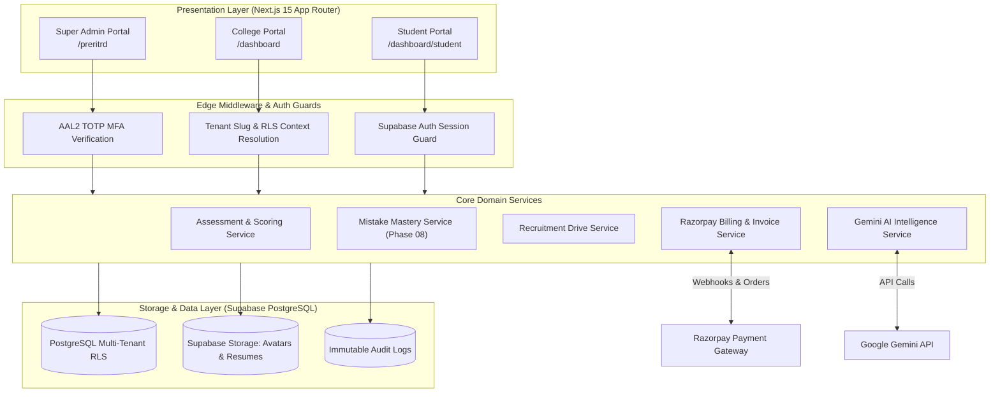
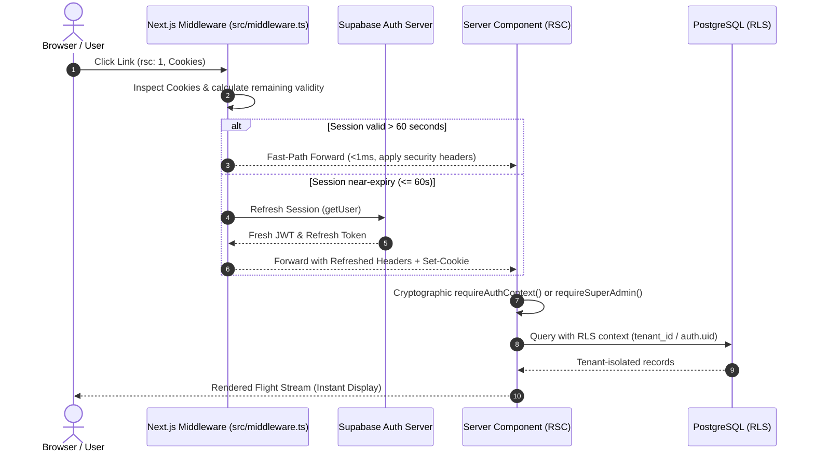
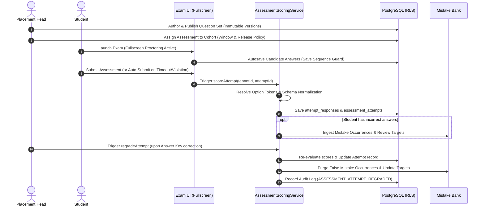
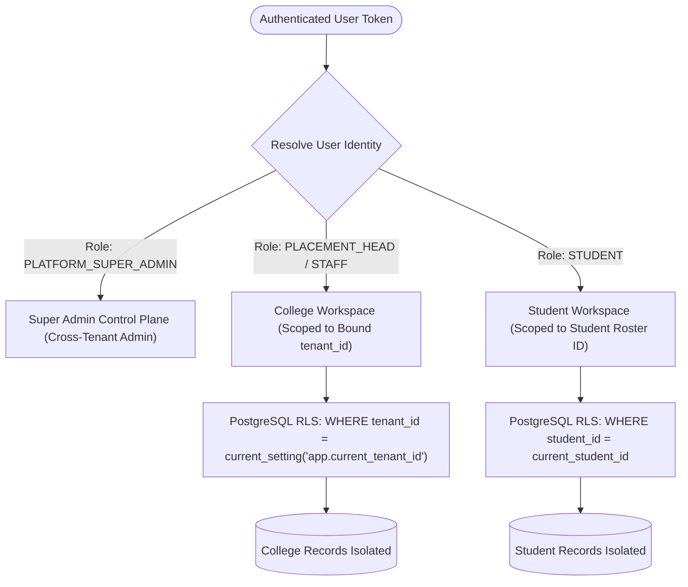
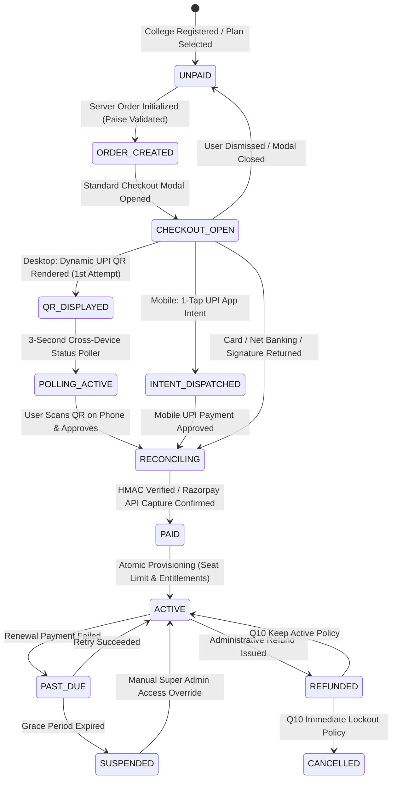
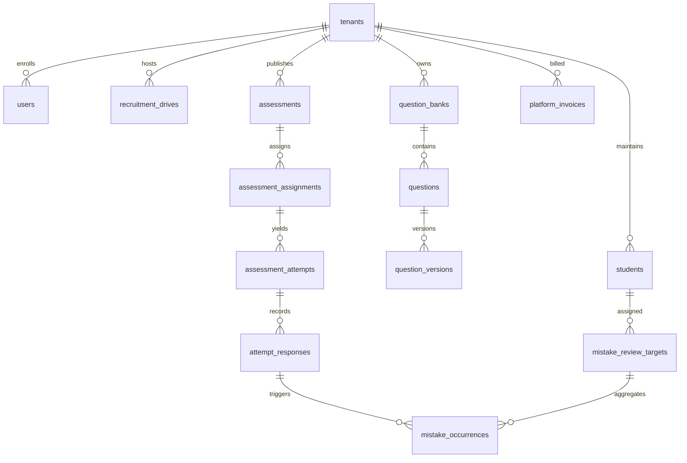

# UrPlaced — Multi-College Placement Management & Preparation SaaS Platform

<div align="center">


**Next-Generation Multi-Tenant Placement Operations, Assessment Integrity & AI Career Preparation Platform**

[](https://nextjs.org/)
[](https://react.dev/)
[](https://www.typescriptlang.org/)
[](https://tailwindcss.com/)
[](https://supabase.com/)
[](https://razorpay.com/)
[](https://ai.google.dev/)
[](https://vitest.dev/)

</div>

---

## 📌 Table of Contents

- [Overview](#-overview)
- [Key Portals & User Roles](#-key-portals--user-roles)
- [Core Functional Modules](#-core-functional-modules)
  - [1. Multi-Tenant Tenancy & Single-College Ownership](#1-multi-tenant-tenancy--single-college-ownership)
  - [2. Question Bank Sentinel & Versioning](#2-question-bank-sentinel--versioning)
  - [3. Assessment Engine & Grading Integrity](#3-assessment-engine--grading-integrity)
  - [4. Phase 08 Mistake Bank & Mastery Engine](#4-phase-08-mistake-bank--mastery-engine)
  - [5. Recruitment Drives & Pipeline Intelligence](#5-recruitment-drives--pipeline-intelligence)
  - [6. DriveFit & AI Placement Insights](#6-drivefit--ai-placement-insights)
  - [7. Placement Memory & Institutional Moderation](#7-placement-memory--institutional-moderation)
  - [8. Platform Super Admin Control Plane](#8-platform-super-admin-control-plane)
  - [9. Institutional Billing, Invoicing & Refunds](#9-institutional-billing-invoicing--refunds)
  - [10. Global Navigation Optimization & Smart Session Validation](#10-global-navigation-optimization--smart-session-validation)
  - [11. Global Maintenance Mode & Full-Screen Tenant Lockdown](#11-global-maintenance-mode--full-screen-tenant-lockdown)
- [System Architecture & Workflows](#-system-architecture--workflows)
  - [High-Level Architecture Diagram](#high-level-architecture-diagram)
  - [Global Maintenance Mode & Lockdown Enforcement Architecture](#global-maintenance-mode--lockdown-enforcement-architecture)
  - [Next.js Middleware & RSC Session Refresh Architecture](#nextjs-middleware--rsc-session-refresh-architecture)
  - [Assessment Lifecycle & Regrading Engine](#assessment-lifecycle--regrading-engine)
  - [Multi-Tenant RLS & Auth Isolation](#multi-tenant-rls--auth-isolation)
  - [Institutional Billing State Machine](#institutional-billing-state-machine)
- [Technology Stack](#-technology-stack)
- [Strict Design System Specification](#-strict-design-system-specification)
- [Database Schema & Migrations](#-database-schema--migrations)
- [Getting Started & Local Setup](#-getting-started--local-setup)
- [Testing & Quality Assurance](#-testing--quality-assurance)
- [Security & Compliance Highlights](#-security--compliance-highlights)
- [Repository Structure](#-repository-structure)
- [License](#-license)

---

## 🚀 Overview

**UrPlaced** is an enterprise-grade, multi-tenant SaaS platform architected specifically for collegiate placement cells, university recruitment departments, candidates, and hiring partners. 

Traditional placement management relies on fractured spreadsheets, unmonitored test links, and disjointed training drills. **UrPlaced** unifies the entire institutional recruitment lifecycle into three rigorously isolated portals:
1. **College Placement Portal:** Authoritative workspace for Placement Heads, Officers, and Trainers to curate question banks, orchestrate company drives, track multi-round pipelines, and schedule secured assessments.
2. **Student Workspace:** High-focus preparation and exam-taking terminal equipped with fullscreen proctoring, instant or policy-governed result releases, and an automated **Mistake Bank** that turns test errors into spaced-repetition mastery drills.
3. **Platform Super Admin (`/preritrd`):** Strict Option A control plane providing zero-trust operational oversight, multi-tenant college onboarding with cryptographically secured invitation tokens, subscription plan catalogue versioning, automated GST billing, credit notes, and decoupled refund management.

---

## 👥 Key Portals & User Roles

| Role | Access Scope | Portal Entry | Core Capabilities |
| :--- | :--- | :--- | :--- |
| **Platform Super Admin** | Global Cross-Tenant Control Plane | `/preritrd` | Tenant lifecycle, plan catalogue versioning, manual subscription overrides, Razorpay payment reconciliation, refunds, global audit logs, system telemetry. |
| **Placement Head** | Institutional Root Owner | `/dashboard` | Complete tenant management, staff invitations, subscription checkout, company drive authoring, assessment publishing, result releases, student directory deletion. |
| **Placement Staff / Trainer** | Institutional Staff | `/dashboard` | Student directory imports, question set creation, test monitoring, cohort training attendance, before-and-after skill delta tracking. |
| **Student / Candidate** | Isolated Student Workspace | `/dashboard/student` | SRN roster claiming, drive application, proctored test taking, score reviews, targeted revision drills, AI tutor chat, resume DriveFit analysis. |

---

## 💡 Core Functional Modules

### 1. Multi-Tenant Tenancy & Single-College Ownership
- **Strict Tenant Isolation:** Enforced via PostgreSQL Row-Level Security (RLS) policies conditioned on `tenant_id` and tenant session contexts.
- **Single-College Ownership Invariant:** Prevents cross-college data leaks or simultaneous college affiliations. A user identity belongs exclusively to one institution or the global platform admin plane.
- **SRN Roster Claiming (Phase 17):** Students claim verified institutional rosters using their college-assigned Student Registration Number (SRN) and verified institutional email domain, ensuring zero unauthorized self-enrollment.

### 2. Question Bank Sentinel & Versioning
- **Immutable Question Versions (`question_versions`):** Edits to live questions never mutate in-flight examination snapshots; each revision commits a deterministic immutable version row.
- **Duplicate Detection Fingerprinting:** SHA-256 semantic fingerprinting over prompt text and option tokens prevents accidental duplicate authoring.
- **Taxonomy Management:** Strict hierarchical classification across Subject &rarr; Topic &rarr; Skill Weight &rarr; Difficulty Level.
- **Bulk Import Engine:** High-speed CSV/Excel parsing with strict schema validation, preview diffs, and automatic question bank creation.

### 3. Assessment Engine & Grading Integrity
- **Multi-Type Question Evaluation:** Authoritative server-side evaluation supporting `SINGLE_CHOICE`, `MULTIPLE_SELECT`, `NUMERIC`, `SHORT_ANSWER`, and `CODING`.
- **Semantic Option Resolution Engine:** Eliminates option-ID mismatches by dynamically reconciling raw candidate choices (`opt_a`, option text, letter `A`, or numeric index) against version option arrays.
- **Numeric Normalization:** Resilient float parsing with automatic currency symbol (`₹`, `$`) and comma stripping alongside strict tolerance checks (`±tolerance`).
- **Autosave & Concurrency Guard:** Optimistic lock sequence tracking prevents race conditions during unstable network connectivity.
- **Exam Proctoring & Security:** Fullscreen enforcement, tab-switch event monitoring, and auto-submission upon security violation thresholds.
- **Result Release Policies:** Granular governance over candidate visibility (`IMMEDIATE`, `MANUAL_STAFF_RELEASE`, `AFTER_DEADLINE`).
- **Automated Regrading & Mistake Reconciliation:** Re-evaluates historical attempts upon question key corrections and immediately purges false defect entries from candidate mistake banks.

### 4. Phase 08 Mistake Bank & Mastery Engine
- **Automated Defect Ingestion:** Test responses marked incorrect or skipped are automatically cataloged into `mistake_occurrences` and grouped into deduplicated `mistake_review_targets`.
- **Spaced Repetition Review:** Stage-based revision lifecycle (Stage 1 to Stage 5) scheduling adaptive re-tests based on candidate learning curves.
- **Targeted Revision Drills:** Interactive student practice environment with authoritative solutions, step-by-step mathematical explanations, and progress metrics.

### 5. Recruitment Drives & Pipeline Intelligence
- **Multi-Round Stage Pipelines:** Configure custom stages (`ONLINE_TEST`, `CODING_TEST`, `TECHNICAL_INTERVIEW`, `HR_INTERVIEW`, `FINAL_SELECTION`).
- **Candidate Advancement Engine:** Fast-track or reject applicants per round with auditable transition history.
- **Eligibility Engine:** Real-time pre-screening matching student CGPA, active backlog thresholds, departments, and graduating batches against job criteria.

### 6. DriveFit & AI Placement Insights
- **Gemini 2.0 Integration:** Deep analysis of job descriptions (JDs) to extract core competencies, tech stacks, and domain expectations.
- **DriveFit Score:** Generates an algorithmic percentage match between student candidate profiles and specific drive requirements, accompanied by actionable gap-closing recommendations.

### 7. Placement Memory & Institutional Moderation
- **Interview Experience Archive:** Crowdsourced candidate interview debriefs detailing company rounds, questions asked, and difficulty ratings.
- **Placement Cell Moderation:** Placement staff inspect, verify, and approve memory records before public cohort publication.

### 8. Platform Super Admin Control Plane
- **Strict Option A Isolation:** Dedicated routes (`/preritrd/*`), separate authentication handlers, and complete isolation from college/student portals.
- **Cryptographic MFA Assurance:** Enforces genuine TOTP MFA (AAL2) claiming via Supabase Auth with zero reliance on client-side state.
- **Onboarding Invitations:** Issue, revoke, and track cryptographically hashed invitations for institutional onboarding.
- **Global Audit Logs:** Comprehensive immutable log tracking every administrative state modification, role change, and deletion action.

### 9. Institutional Billing, Payment Gateway & Financial Reconciliation
- **Razorpay Standard Web Checkout Integration:** End-to-end payment lifecycle via official Razorpay Standard Checkout SDK (`https://checkout.razorpay.com/v1/checkout.js`), enforcing server-authoritative order creation (`POST /api/billing/checkout/create-order`) with server-side paise conversion, INR currency validation, and balance guards.
- **Immediate Dynamic UPI QR Code Presentation (Desktop Web):** Explicitly configured `config.display` with `flow: "qr"` and `flows: ["qr"]` for desktop browsers across PhonePe, Google Pay, Paytm, and BHIM. Eliminates desktop protocol handler failures (`phonepe://pay?...`) and renders an instant dynamic scannable QR code on the very first attempt without failure screens.
- **Mobile 1-Tap UPI Intent Flow:** Automatic device detection (`isMobile`) routing smartphone users to native 1-tap app switching (`flows: ["intent", "qr"]`) for seamless mobile checkouts.
- **Real-Time Cross-Device Status Polling (`/api/billing/checkout/status`):** Active 3-second background status polling while the checkout modal is open. When a user scans the desktop QR code using PhonePe on their phone, the backend detects payment capture directly via Razorpay API, automatically closes the checkout modal, and activates institutional entitlements in real time.
- **Cryptographic Signature Verification (`/api/billing/checkout/verify`):** Raw HMAC-SHA256 signature verification over `order_id + "|" + payment_id` against `RAZORPAY_KEY_SECRET` before marking transactions settled.
- **Atomic Payment Reconciliation Service (`PaymentReconciliationService`):** Single-execution idempotent settlement transitioning invoices to `PAID`, subscriptions to `ACTIVE`, updating student seat allocations, and recording immutable audit logs.
- **Dynamic Subscription Plan Pricing:** Platform Admin plan editor updates dynamically synchronize across all public registration forms (`/preritrd/colleges/new`) and billing dashboards (`/dashboard/billing`), eliminating hardcoded plan prices.
- **Automated Tax Calculations & Invoicing:** 18% GST (CGST + SGST for Karnataka; IGST inter-state) computed with automated credit note generation.
- **Dual-Identifier PDF Invoice & Credit Note Downloads:** High-resiliency binary PDF generation supporting lookups by UUID and human-readable invoice identifiers (`INV-YYYY-XXXX`).
- **Decoupled Administrative Refunds (Q10 & Q20):** Super Admin refunds with explicit subscription lifecycle governance (`KEEP_ACTIVE`, `CANCEL_IMMEDIATELY`, `CANCEL_AT_PERIOD_END`).

### 10. Global Navigation Optimization & Smart Session Validation
- **Sub-10ms Route Transitions:** Eliminates client-side route lag across College, Student, and Super Admin portals.
- **Smart Session Evaluation (`shouldRefreshToken`):** Edge middleware parses encrypted/chunked auth session cookies in microseconds ($\approx 0.05$ms). Sessions valid for $>60$s skip redundant remote Supabase network round-trips entirely.
- **Near-Expiry Auto-Refresh:** Sessions within $\le 60$s of expiration trigger authoritative token refresh, updating `Set-Cookie` headers seamlessly for downstream Server Components and browser storage.
- **Speculative Background Prewarming:** `app-shell.tsx` and `platform-nav.tsx` utilize `requestIdleCallback` (with timer fallback) to warm authorized route payloads without consuming network bandwidth during critical paint.
- **Instant Optimistic Visual Transitions (`pendingHref`):** Synchronously updates active link indicators ($<4$ms) and displays a 2px brand gradient progress bar (`linear-gradient(135deg, #7779D8 0%, #5052C9 100%)`) during page load.
- **Fail-Closed Security Invariant:** Speculative prefetch and RSC requests fail closed without disclosing sensitive student records or placement telemetry to unauthenticated callers.

### 11. Global Maintenance Mode & Full-Screen Tenant Lockdown
- **Defense-in-Depth Lockdown Engine:** Centrally configured via Super Admin platform switches (`/preritrd/configuration`), enforcing an absolute, full-screen maintenance interface whenever `maintenance_mode = TRUE`.
- **Viewport-Perfect Lockdown & Zero Scrollbar:** Rendered in an ultra-modern, viewport-locked full-screen canvas (`h-[100dvh] overflow-hidden`) with authentic official `UrPlacedLogo` website branding, animated platform telemetry radar, and zero browser scrollbars.
- **Complete Tenant UI Erasure:** Replaces all normal navigation, sidebar, application header, user profile controls, dashboard widgets, and child routes (`/dashboard/*`, `/dashboard/student/*`) with `<FullScreenMaintenance />`. Never renders as a banner or dismissible overlay.
- **Zero Content Flash & Server-Side Security:** Root `DashboardLayout` checks `PlatformConfigService.getMaintenanceStatus()` before streaming any child React Server Component (RSC), preventing in-flight data leaks or initial rendering flash.
- **HTTP 503 Service Unavailable API Guard:** Intercepts incoming non-exempt tenant API requests (`/api/student/*`, `/api/placement/*`, `/api/notifications/*`, etc.) at the Edge middleware and Server Context layer (`requireAuthContext`), returning status 503 with dynamic broadcast payload and `Retry-After: 300` headers.
- **Strict Super Admin Exemption:** Super Admin control plane (`/preritrd/*`) and management APIs (`/api/preritrd/*`) remain 100% accessible to verified Super Admins to monitor telemetry, update broadcast messaging, or restore operations.
- **Critical Integrations Preserved:** Razorpay webhooks (`/api/billing/webhook`, `/api/webhooks/razorpay`), subscription checkouts (`/api/billing/checkout/*`), auth callbacks/signout (`/auth/*`, `/api/auth/signout`), and maintenance status telemetry (`/api/platform/maintenance`) remain operational during lockdown.
- **In-Memory Caching & Sub-Second Propagation:** 5-second in-memory TTL caching in `PlatformConfigService` and Edge Middleware eliminates database latency while immediately invalidating upon Super Admin configuration save.

---

## 🏗 System Architecture & Workflows

### High-Level Architecture Diagram



---

### Global Maintenance Mode & Lockdown Enforcement Architecture

```mermaid
sequenceDiagram
    autonumber
    actor Tenant as Student / Placement Staff
    actor Admin as Super Admin (/preritrd)
    participant MW as Next.js Edge Middleware
    participant DL as DashboardLayout (Server Component)
    participant Shell as AppShell (Client Polling)
    participant API as Tenant API / Server Context
    participant DB as Supabase PostgreSQL

    Admin->>DB: PATCH /api/preritrd/configuration (maintenance_mode = true)
    DB-->>Admin: Saved & Audit Event Recorded
    Note over MW,DB: Maintenance Cache invalidated; 5s TTL syncs across edge

    rect rgb(240, 240, 240)
    Note over Tenant,API: Scenario A: Direct URL Navigation (/dashboard/*)
    Tenant->>MW: GET /dashboard/student
    MW->>MW: Check checkGlobalMaintenance() -> TRUE & !isSuperAdmin
    MW-->>Tenant: Rewrite to /maintenance (Zero flash, HTTP headers set)
    end

    rect rgb(240, 240, 240)
    Note over Tenant,DL: Scenario B: Server-Side RSC Request
    Tenant->>DL: Request /dashboard
    DL->>DL: PlatformConfigService.getMaintenanceStatus() -> TRUE
    DL-->>Tenant: Render <FullScreenMaintenance /> (Zero child RSC / DB queries)
    end

    rect rgb(240, 240, 240)
    Note over Tenant,API: Scenario C: Tenant-Facing API Request
    Tenant->>API: GET /api/student/dashboard
    API->>API: requireAuthContext() checks maintenance
    API-->>Tenant: HTTP 503 SERVICE_UNAVAILABLE { maintenance: true, announcement }
    end

    rect rgb(240, 240, 240)
    Note over Tenant,Shell: Scenario D: Open Tab Dynamic Transition
    Shell->>API: 10s Poll GET /api/platform/maintenance
    API-->>Shell: 200 OK { enabled: true, message: "..." }
    Shell->>Shell: Swap entire DOM tree to <FullScreenMaintenance />
    end
```

---

### Next.js Middleware & RSC Session Refresh Architecture



---

### Assessment Lifecycle & Regrading Engine



---

### Multi-Tenant RLS & Auth Isolation



---

### Institutional Billing State Machine



---

## 🛠 Technology Stack

| Domain | Technology / Library | Version | Purpose |
| :--- | :--- | :--- | :--- |
| **Framework** | Next.js (App Router) | `15.1.12` | Server Components, Server Actions, Route Handlers, Streaming UI |
| **Runtime / Language** | Node.js / TypeScript | `5.7.3` | Strict Type-Safety, Complete Domain Typing |
| **Frontend Core** | React | `19.0.0` | Declarative UI, Concurrent Rendering |
| **Styling** | Tailwind CSS / PostCSS | `3.4.17` | Utility-First CSS with strict token variables |
| **Component Primitives** | Radix UI | Latest | Accessible Dialogs, Dropdowns, Tabs, Tooltips, Switches |
| **Iconography** | Lucide React | `0.475.0` | Consistent SVG icon system |
| **Database & Auth** | Supabase PostgreSQL | `2.118.0` | Multi-Tenant Database, RLS Policies, Supabase Auth, Storage |
| **Payment Gateway** | Razorpay SDK | `2.9.8` | Institutional Subscriptions, Invoicing, Webhooks, Refunds |
| **Artificial Intelligence**| Google Gen AI SDK | `2.31.0` | Question Generation, DriveFit Analysis, Mistake Analysis |
| **Document Generation** | ExcelJS & PDFKit | `4.4.0` / `0.20.2` | Roster import/export, Invoice PDF & Credit Note generation |
| **Testing** | Vitest & Testing Library | `3.0.5` / `16.2.0` | Unit & integration testing across 111 test suites |

---

## 🎨 Strict Design System Specification

UrPlaced adheres to a strict, non-negotiable visual design identity defined in `GEMINI.md`:

### Base Color Palette

| Role | Token / Hex | Usage |
| :--- | :--- | :--- |
| **Primary** | `#5052C9` | Key action buttons, active tabs, focus highlights, primary indicators |
| **Secondary Accent** | `#2E8F86` | Badges, success callouts, secondary metrics, verification indicators |
| **Background** | `#EDECE7` | Main page background, root container surface |
| **Card Background** | `#F8F7F3` | Cards, sidebars, modals, elevated surfaces |
| **Input Background** | `#FBFAF7` | Form inputs, select menus, textareas, search fields |
| **Primary Text** | `#24283A` | Headings, high-emphasis text, body copy |
| **Secondary Text** | `#292D40` | Subtitles, labels, captions, metadata |
| **Primary Gradient** | `linear-gradient(135deg, #7779D8 0%, #5052C9 100%)` | Hero callouts, primary CTA buttons |

### Typography Stacks
- **Headings & Display:** `Outfit`, sans-serif (Weights: 500, 600, 700)
- **Body Text & UI Controls:** `Inter`, sans-serif (Weights: 400, 500, 600)
- **Code & Monospace:** `JetBrains Mono`, monospace (Weights: 400, 500)

---

## 🗄 Database Schema & Migrations

The database is built on PostgreSQL inside Supabase, featuring 33 immutable migrations:

```
supabase/migrations/
├── 20261018000001_phase03_auth_tenancy_rls.sql
├── 20261018000002_phase04_college_placement.sql
├── 20261018000003_phase05_recruitment_intelligence_drivefit.sql
├── 20261018000004_phase06_questionbank_sentinel.sql
├── 20261019000001_phase07_assessment_engine.sql
├── 20261019000002_phase08_mistake_to_mastery.sql
├── 20261019000003_phase09_placement_memory_analytics.sql
├── 20261021000001_phase10_user_profiles_enhancements.sql
├── 20261022000001_phase11_avatar_storage_persistence.sql
├── 20261025000001_phase12_ai_intelligence_persistence.sql
├── 20261025000002_phase13_notifications_system.sql
├── 20261027000001_phase14_srn_roster_claiming.sql
├── 20261028000002_multi_college_srn_claiming.sql
├── 20261030000001_enforce_single_college_ownership.sql
├── 20261030000003_enforce_strict_platform_admin_isolation.sql
├── 20261031000001_platform_super_admin_portal.sql
├── 20261101000001_college_onboarding_invitations.sql
├── 20261101000002_subscription_plans_and_entitlements.sql
├── 20261101000004_sa05_payment_invoicing_billing.sql
├── 20261101000005_sa06_payment_gated_access_control.sql
└── 20261103000001_student_assessment_security_and_violations.sql
```

### Core Database Tables



---

## 🚦 Getting Started & Local Setup

### Prerequisites
- **Node.js:** `v20.x` or higher
- **Package Manager:** `npm` (v10+)
- **Supabase Account:** Dedicated project with PostgreSQL instance
- **Razorpay Account (Test Mode):** Key ID and Key Secret
- **Gemini API Key:** From Google AI Studio

### 1. Clone the Repository
```bash
git clone https://github.com/Preritrd5/UrPlaced.git
cd UrPlaced
```

### 2. Install Dependencies
```bash
npm install
```

### 3. Configure Environment Variables
Create a `.env.local` file in the root directory:

```env
# Supabase Configuration
NEXT_PUBLIC_SUPABASE_URL=https://your-project.supabase.co
NEXT_PUBLIC_SUPABASE_ANON_KEY=your-supabase-anon-key
SUPABASE_SERVICE_ROLE_KEY=your-supabase-service-role-key

# Razorpay Payment Gateway (Live Mode or Test Mode)
RAZORPAY_MODE=live
NEXT_PUBLIC_RAZORPAY_KEY_ID=rzp_live_your_key_id
RAZORPAY_KEY_ID=rzp_live_your_key_id
RAZORPAY_KEY_SECRET=your_razorpay_secret
RAZORPAY_WEBHOOK_SECRET=your_webhook_secret

# Google Gemini AI
GEMINI_API_KEY=your_gemini_api_key

# Application Base URL
NEXT_PUBLIC_APP_URL=http://localhost:3000
```

### 4. Push Database Migrations
```bash
npx supabase db push
```

### 5. Provision the Initial Super Admin Account
```bash
npm run admin:create
```

### 6. Run the Development Server
```bash
npm run dev
```
Open [http://localhost:3000](http://localhost:3000) to view the portal.
- Super Admin login: `http://localhost:3000/preritrd/login`
- College portal login: `http://localhost:3000/login`
- Student workspace login: `http://localhost:3000/student/login`

---

## 🧪 Testing & Quality Assurance

UrPlaced maintains a comprehensive automated testing suite powered by **Vitest** and **Testing Library**.

```bash
# Run all 123 test suites (1,409 unit & integration tests)
npm test

# Run tests in watch mode
npm run test:watch

# Execute strict TypeScript type verification
npm run type-check

# Run Next.js linting
npm run lint

# Run controlled production-build navigation latency benchmarks
npx tsx scripts/run-production-benchmarks.ts
```

### Test Suite Execution Metrics
- **Total Test Suites:** `123 passing`
- **Total Unit & Integration Tests:** `1,409 passing (100% Pass Rate)`
- **TypeScript Errors:** `0`
- **Navigation & Multi-Portal Security Audit Suite:**
  - `navigation-latency-security-audit.test.ts` (17 tests): Verifies fail-closed RSC and segment-prefetch endpoints, rejection of forged/expired cookies and invalid Bearer tokens, strict multi-college tenant isolation, student privacy boundaries, and Super Admin AAL2 MFA enforcement.
- **Payment & Financial Test Coverage:**
  - `sa08-subscription-payment-flow-audit.test.ts`: Server-authoritative order creation, paise computation, and balance validation.
  - `sa09-invoice-download-and-rendering.test.ts`: PDF invoice and credit note dual-identifier lookup and binary stream verification.
  - `sa10-razorpay-upi-qr-and-status-polling.test.ts`: Desktop UPI dynamic QR configuration (`flows: ["qr"]`) and 3-second cross-device payment reconciliation polling.
  - `sa11-dynamic-college-registration-plans.test.ts`: Dynamic subscription plan pricing resolution on college onboarding and capacity synchronization.
- **Platform Invariants Covered:** PostgreSQL RLS tenant isolation, CVE-2026-44575 flight-sanitization verification, CSRF/SSRF guards, Super Admin AAL2 TOTP MFA authentication, question duplicate fingerprinting, autosave race conditions, assessment grading integrity, Mistake Bank spaced repetition, and Razorpay HMAC-SHA256 signature verification.

---

## 🔒 Security & Compliance Highlights

- **Next.js Security Hardening (CVE-2026-44575 / CVE-2025-66478):** Powered by Next.js 15.1.12 with full mitigation against RSC flight-header deserialization and middleware rewrite exploits.
- **Fail-Closed RSC & Segment Prefetching:** Speculative prefetch and RSC transitions fail closed; unauthorized callers receive zero protected data, student records, or institutional metrics.
- **Dual-Layer Authorization:** Lightweight edge middleware optimizes session cookie refresh in $<0.1$ms without performing access control decisions, while downstream Server Components and API Route Handlers enforce authoritative cryptographic identity and permission checks (`requireAuthContext` & `PlatformAuthService.requireSuperAdmin`).
- **Row Level Security (RLS):** Enabled and strictly enforced on all public schema tables; cross-tenant queries fail deterministically at the database engine level.
- **Strict Option A Super Admin Boundaries:** Administrative routes require dedicated cookies and cryptographically verified MFA claims, blocking session reuse from college or student logins.
- **SSRF Defense:** URL ingestion routines strictly validate outgoing requests against reserved private IP ranges (`10.0.0.0/8`, `172.16.0.0/12`, `192.168.0.0/16`, `127.0.0.0/8`).
- **Cryptographic Signature & Webhook Verification:** Razorpay Standard Checkout verify route and webhooks validate raw HMAC-SHA256 signatures before processing order settlements or refunds.
- **Cross-Device Status Polling & Idempotent Reconciliation:** Backend-verified polling reconciles external UPI payments with Razorpay Live API directly, preventing double charges or duplicate subscription provisioning.
- **Audit Logging:** Administrative operations emit immutable audit trail entries into `public.audit_logs`.

---

## 📁 Repository Structure

```
UrPlaced/
├── public/                     # Brand assets, logos, and static resources
├── scripts/                    # Administrative CLI utilities & benchmarks
│   ├── provision-super-admin.ts
│   └── run-production-benchmarks.ts
├── src/
│   ├── app/                    # Next.js App Router (Layouts, Pages, Route Handlers)
│   │   ├── (auth)/             # Shared college and student login / signup flows
│   │   ├── api/                # RESTful API Route Handlers
│   │   │   ├── ai/             # Gemini AI endpoints (classify, generate, tutor)
│   │   │   ├── billing/        # Razorpay checkout & webhook handlers
│   │   │   ├── placement/      # Drives, assessments, questions, students
│   │   │   ├── preritrd/       # Platform Super Admin protected API routes
│   │   │   └── student/        # Candidate attempts, applications, mistakes
│   │   ├── dashboard/          # College Placement Head & Staff Portal
│   │   │   └── student/        # Student Preparation & Examination Workspace
│   │   └── preritrd/           # Platform Super Admin Control Plane Portal
│   ├── components/             # Reusable UI & Domain Components
│   │   ├── common/             # Brand loaders, headers, navigation
│   │   ├── layout/             # App shell with instant optimistic transitions
│   │   ├── platform-admin/     # Super Admin cards, navbars, audit tables
│   │   ├── questions/          # Question bank forms, modals, import wizards
│   │   └── ui/                 # Radix UI primitives with Tailwind design tokens
│   ├── lib/                    # Shared utilities, Supabase clients, payment SDK
│   ├── middleware.ts           # High-performance Next.js session validation
│   ├── modules/                # Domain-Driven Core Services
│   │   ├── assessments/        # Scoring engine, attempts, assignment lifecycle
│   │   ├── billing/            # Razorpay plans, invoicing, refunds, reconciliation
│   │   ├── identity-access/    # Policy engine, role permissions, MFA
│   │   ├── mistake-mastery/    # Phase 08 Mistake Bank & spaced repetition
│   │   ├── question-bank/      # QuestionBank Sentinel, duplicate detection
│   │   ├── recruitment-drives/ # Drive pipelines & applicant tracking
│   │   └── tenancy/            # Multi-tenant isolation & membership management
│   ├── test/                   # Comprehensive Vitest test suite (123 test files)
│   └── types/                  # TypeScript database and domain type definitions
├── supabase/                   # Supabase configuration & PostgreSQL migrations
├── GEMINI.md                   # Authoritative Design System Specification & Rules
├── package.json                # Project dependencies and operational scripts
├── tailwind.config.ts          # Tailwind tokens mapped to UrPlaced palette
├── tsconfig.json               # Strict TypeScript configuration
└── vitest.config.ts            # Test runner configuration
```

---

## 📄 License

UrPlaced is proprietary software. All rights reserved. Unauthorized reproduction, distribution, or reverse-engineering is strictly prohibited.

---

<div align="center">
  <sub>Engineered with precision for institutions, placement leaders, and aspiring candidates.</sub>
</div>
