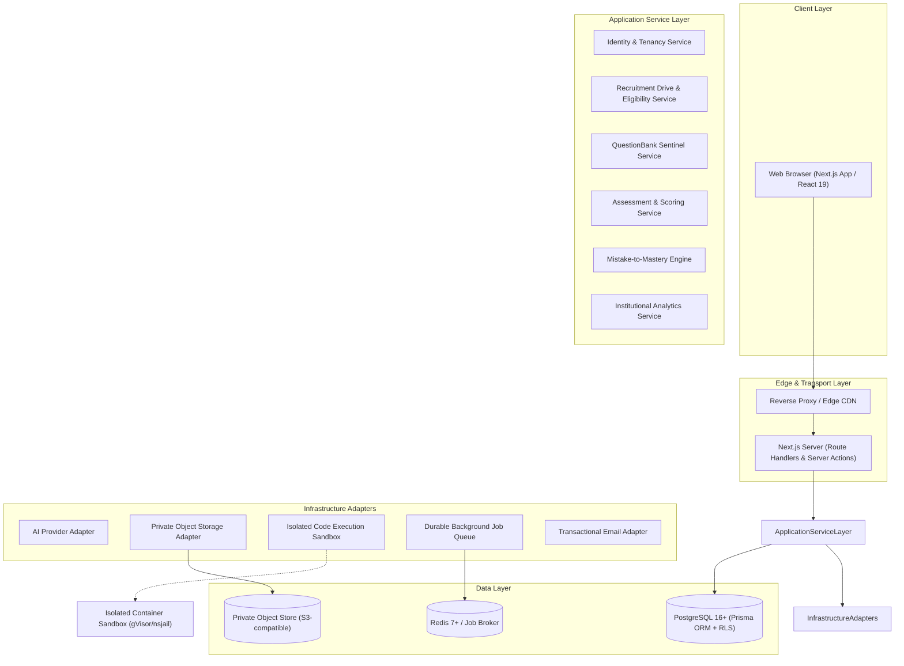
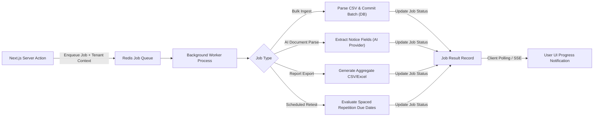

# System Architecture & Technical Specifications — UrPlaced V1.0

**Product:** UrPlaced — Multi-College Placement Preparation & Management SaaS  
**Phase:** 01 — Product Blueprint & Architecture  
**Status:** Approved Specification  

---

## 1. Architectural Style: Modular Monolith

UrPlaced is architected as a **strictly modular monolith**. Microservices are deliberately avoided for V1.0 to eliminate distributed transaction failures, network latency overhead, and deployment complexity while preserving clean domain boundaries.

### Architectural Invariants:
1. **Isolated Domain Boundaries:** Domain modules communicate through explicit TypeScript interfaces and service contracts. Modules never execute raw SQL or mutate state across another module's internal domain entities.
2. **Heavy Workload Asynchrony:** Resource-intensive tasks (bulk CSV ingestion, AI notice extraction, coding problem test runs, PDF report generation) are dispatched to background workers via a durable queue abstraction.
3. **Provider-Agnostic Adapters:** All external infrastructure dependencies (AI models, object storage, email delivery, code sandboxes) sit behind pluggable interfaces.



---

## 2. Core Technology Stack

| Component | Selected Technology | Technical Justification |
| :--- | :--- | :--- |
| **Framework** | Next.js 15+ (App Router, React 19) | Server Components for secure data reads; streaming SSR; co-located server actions for low-latency writes. |
| **Language** | TypeScript 5+ (Strict Mode) | End-to-end type safety, compile-time contract enforcement, zero `any` tolerance. |
| **Styling & UI** | Tailwind CSS + Radix UI Primitives | Accessible WCAG 2.1-compliant UI headless primitives styled strictly to UrPlaced's brand tokens. |
| **Database** | Managed PostgreSQL 16+ | ACID compliance, JSONB for dynamic eligibility rules, native Row-Level Security (RLS) for tenant isolation. |
| **ORM & Migrations** | Prisma ORM | Type-safe query building, versioned migrations checked into Git, declarative schema as the system of record. |
| **Authentication** | Better Auth (with Prisma Adapter) | Email/password, secure httpOnly session cookies, email verification, password reset, and robust extensibility. |
| **Forms & Validation** | React Hook Form + Zod | Client/server shared schemas guaranteeing unified input validation. |
| **Tables & Charts** | TanStack Table v8 + Recharts | Virtualized high-performance tables; customized data visualization matching exact color tokens. |
| **Job Queue** | BullMQ + Redis (or PgBoss on Postgres) | Durable delayed/recurring job execution, exponential backoff retries, and job progress reporting. |
| **Object Storage** | S3-Compatible API (AWS S3 / Cloudflare R2) | Private buckets with short-lived pre-signed upload/download URLs. No public direct bucket access. |
| **Code Execution** | Isolated Judge Runner (Judge0 / nsjail) | Sandboxed evaluation of untrusted student code with CPU, memory, time, and network isolation. |

---

## 3. Logical Domain Module Boundaries

The monolith is partitioned into 16 discrete domain modules under `src/modules/`:

```
src/modules/
├── identity-access/         # User accounts, sessions, password reset, auth policies
├── tenancy/                 # Colleges, subscriptions, seat quotas, tenant metadata
├── academic/                # Departments, degree programs, cohorts, student rosters
├── companies/               # Company profiles, hiring history, recruiter contacts
├── recruitment-drives/      # Drives, job roles, rounds, deadlines, notices
├── eligibility/             # Criteria DSL, evaluation engine, manual overrides
├── recruitment-intel/       # Source documents, verification logs, historical rounds
├── question-bank/           # Questions, versions, topics, duplicate checks, tags
├── assessments/             # Test definitions, assignments, autosave, server timing
├── code-execution/          # Code submission dispatch, sandbox adapter, test suites
├── mistake-mastery/         # Mistake Bank, revision scheduler, retest generators
├── training/                # Workshops, sessions, attendance, diagnostic assessments
├── placement-memory/        # Moderated candidate reports, interview archives
├── analytics/               # Cohort heatmaps, readiness indices, export services
├── storage/                 # Pre-signed URL generation, MIME validation, metadata
└── notifications/           # In-app notification center, email template dispatch
```

---

## 4. Server vs. Client Responsibilities

| Responsibility | Client Component (`'use client'`) | Server Component / Action / Service |
| :--- | :---: | :---: |
| **Authentication & Session Validation** | Read session display state | **Authoritative:** Validates JWT/cookie & membership |
| **Tenant Scoping & Access Control** | None (Untrusted) | **Authoritative:** Enforces DB tenant ID injection & RLS |
| **Eligibility Determination** | Displays transparent reasons | **Authoritative:** Computes boolean criteria server-side |
| **Assessment Timer** | Displays countdown UX | **Authoritative:** Server records start/end timestamps |
| **Answer Scoring** | None | **Authoritative:** Answer keys never sent to client |
| **Code Execution** | Monaco / CodeMirror editor | **Authoritative:** Sandboxed execution via isolated runner |
| **Input Validation** | Immediate client feedback | **Authoritative:** Zod schema validation before persistence |
| **File Byte Ingestion** | Direct-to-S3 pre-signed upload | **Authoritative:** Generates pre-signed URL after size check |

---

## 5. Background Processing & Worker Topology

Long-running jobs must not block Next.js server threads. A dedicated background worker process consumes jobs from the queue broker:



### Background Execution Rules:
- **Tenant Context Preservation:** Every enqueued job payload must explicitly carry `tenantId`, `actorUserId`, and `jobCorrelationId`.
- **Idempotency Guarantee:** Jobs must be retry-safe using unique idempotency keys (e.g., `import_job_<tenantId>_<fileHash>`).
- **Graceful Failure Backoff:** Exponential retry backoff: 3 retries max at 5s, 30s, and 120s before marking `FAILED` with diagnostic logs.

---

## 6. External Provider Abstraction Layer

### 1. AI Provider Adapter Interface (`AIProviderAdapter`)
```typescript
export interface AIProviderAdapter {
  extractDriveNotice(params: {
    pdfBuffer: Buffer;
    tenantId: string;
  }): Promise<DriveNoticeExtractionResult>;

  generateIsomorphicQuestion(params: {
    originalQuestion: QuestionSnapshot;
    targetTopic: string;
    difficulty: DifficultyLevel;
  }): Promise<GeneratedQuestionProposal>;

  explainMistake(params: {
    question: QuestionSnapshot;
    studentAnswer: string;
    correctAnswer: string;
  }): Promise<string>;
}
```
*Guarantees: Strict Zod validation on AI output JSON schemas. Source separation prevents prompt injection from uploaded files.*

### 2. Isolated Code Execution Adapter (`CodeExecutionRunner`)
```typescript
export interface CodeExecutionRunner {
  runCode(params: {
    language: 'python' | 'java' | 'cpp' | 'javascript';
    sourceCode: string;
    stdin: string;
    timeLimitMs: number;
    memoryLimitMb: number;
  }): Promise<ExecutionResult>;

  evaluateTestCases(params: {
    language: string;
    sourceCode: string;
    testCases: Array<{ stdin: string; expectedStdout: string; isHidden: boolean }>;
  }): Promise<TestSuiteEvaluationResult>;
}
```
*Guarantees: Hard limits (2s CPU time, 256MB RAM), complete network egress block, unprivileged execution.*

### 3. Object Storage Adapter (`ObjectStorageAdapter`)
```typescript
export interface ObjectStorageAdapter {
  createPresignedUploadUrl(params: {
    tenantId: string;
    fileCategory: 'notice' | 'resume' | 'import_csv' | 'export_report';
    fileName: string;
    contentType: string;
    maxBytes: number;
  }): Promise<{ uploadUrl: string; storageKey: string; expiresAt: Date }>;

  createPresignedDownloadUrl(params: {
    storageKey: string;
    tenantId: string;
    ttlSeconds?: number;
  }): Promise<string>;
}
```
*Guarantees: Keys are scoped as `tenant_${tenantId}/${category}/${uuid}_${fileName}`. Direct public reads are disabled.*

---

## 7. Deployment Topography & Infrastructure Topology

```
[Internet Users]
       │
   (HTTPS / TLS 1.3)
       ▼
[Cloud Load Balancer / Reverse Proxy (WAF + DDoS Mitigation)]
       │
 ┌─────┴────────────────────────────────────────────────┐
 │ Next.js Monolith Web Cluster (Managed Host / K8s)    │
 │ - Next.js App Router (SSR + Server Actions)          │
 │ - Better Auth Middleware                             │
 └─────┬──────────────────────────┬─────────────────────┘
       │ (Internal VPC)           │ (Private Job Queue)
       ▼                          ▼
 ┌──────────────────────┐   ┌───────────────────────────────┐
 │ Managed PostgreSQL   │   │ Background Worker Cluster     │
 │ 16+ Primary (with    │   │ (Bulk Ingestion, AI Jobs,     │
 │ Connection Pooling)  │   │ Spaced Repetition Retests)    │
 └──────────────────────┘   └──────┬────────────────────────┘
       ▲                           │ (Isolated Network)
       │                           ▼
 ┌─────┴────────────────┐   ┌───────────────────────────────┐
 │ Read-Only Replica    │   │ Isolated Code Sandbox Pods    │
 │ (Reporting/Analytics)│   │ (Judge0 / nsjail - No Egress) │
 └──────────────────────┘   └───────────────────────────────┘
```
