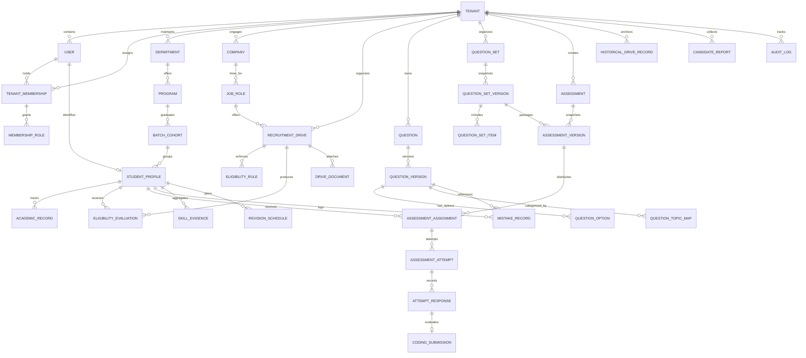

# Data Model & Schema Specifications — UrPlaced V1.0

**Product:** UrPlaced — Multi-College Placement Preparation & Management SaaS  
**Phase:** 01 — Product Blueprint & Architecture  
**Status:** Approved Specification  

---

## 1. Data Modeling Principles & Invariants

1. **Mandatory Tenant Scoping:** Every operational database table has an indexed, non-nullable `tenant_id` foreign key referencing `tenants(id)`, either directly or through an enforced immutable parent entity.
2. **Snapshot Versioning:** Content entities whose mutations would corrupt historical attempts (such as Questions, Answer Keys, Question Sets, and Assessments) utilize immutable version snapshots (`QuestionVersion`, `QuestionSetVersion`, `AssessmentVersion`). Attempts point to immutable snapshots, never to mutable draft records.
3. **Transparent Provenance:** All recruitment intelligence, questions, and reports carry explicit provenance fields: `source_type`, `source_url`, `verification_status`, and `verified_by_user_id`.
4. **Audit Immutability:** Audit logs and operational events are append-only. No `UPDATE` or `DELETE` permissions exist on these tables even for administrative accounts.

---

## 2. Entity-Relationship Diagram (ERD)



---

## 3. Entity Family Specifications

### Family 1: Identity, Tenancy & Access Governance

#### `tenants`
| Field | Type | Modifiers | Description |
| :--- | :--- | :--- | :--- |
| `id` | `UUID` | PK, Default gen_random_uuid() | Unique institution identifier |
| `slug` | `VARCHAR(64)` | Unique, Non-null | URL subdomain slug (e.g. `pes-university`) |
| `legal_name` | `VARCHAR(255)` | Non-null | Official name of the college/university |
| `primary_domain` | `VARCHAR(128)` | Unique, Non-null | Primary email domain (e.g. `pes.edu`) |
| `is_active` | `BOOLEAN` | Non-null, Default true | Tenant operational status |
| `student_seat_limit` | `INTEGER` | Non-null, Default 1000 | Licensed student enrollment capacity |
| `created_at` | `TIMESTAMPTZ` | Non-null, Default now() | Creation timestamp |

#### `users`
| Field | Type | Modifiers | Description |
| :--- | :--- | :--- | :--- |
| `id` | `UUID` | PK, Default gen_random_uuid() | Unique global user identifier |
| `email` | `VARCHAR(255)` | Unique, Non-null | Primary verified email address |
| `password_hash` | `VARCHAR(255)` | Nullable (for OAuth/SSO) | Argon2id password hash |
| `full_name` | `VARCHAR(128)` | Non-null | Full display name |
| `is_platform_admin`| `BOOLEAN` | Non-null, Default false | Platform Super Admin flag |
| `email_verified_at`| `TIMESTAMPTZ`| Nullable | Timestamp when email was confirmed |

#### `tenant_memberships`
| Field | Type | Modifiers | Description |
| :--- | :--- | :--- | :--- |
| `id` | `UUID` | PK | Membership link identifier |
| `tenant_id` | `UUID` | FK -> tenants(id), Non-null | Tenant scope |
| `user_id` | `UUID` | FK -> users(id), Non-null | User reference |
| `membership_status`| `VARCHAR(32)`| Non-null | `ACTIVE`, `INVITED`, `SUSPENDED` |
| *Constraint* | Unique | `(tenant_id, user_id)` | Single membership per tenant |

#### `membership_roles` & `roles`
- `roles`: `id`, `name` (`PLACEMENT_HEAD`, `STAFF_COORDINATOR`, `TRAINER`, `STUDENT`), `description`.
- `membership_roles`: `membership_id` (FK), `role_id` (FK), `assigned_by_user_id`.
- `permissions`: `id`, `identifier` (e.g. `drives.manage`, `questions.review`).
- `role_permissions`: `role_id` (FK), `permission_id` (FK).

---

### Family 2: Academic & Student Administration

#### `departments` & `programs`
- `departments`: `id`, `tenant_id`, `code` (e.g. `CSE`), `name` (`Computer Science and Engineering`).
- `programs`: `id`, `tenant_id`, `department_id`, `name` (`B.Tech`), `duration_years` (`4`).
- `batch_cohorts`: `id`, `tenant_id`, `program_id`, `graduation_year` (`2026`), `label` (`Class of 2026`).

#### `student_profiles`
| Field | Type | Modifiers | Description |
| :--- | :--- | :--- | :--- |
| `id` | `UUID` | PK | Profile identifier |
| `tenant_id` | `UUID` | FK -> tenants(id), Non-null | Enforced tenant scope |
| `user_id` | `UUID` | FK -> users(id), Unique | Linked user account |
| `cohort_id` | `UUID` | FK -> batch_cohorts(id) | Graduating cohort |
| `roll_number` | `VARCHAR(64)` | Non-null | Institutional roll/registration number |
| `current_cgpa` | `NUMERIC(4,2)`| Non-null | Up-to-date cumulative grade point average |
| `active_backlogs` | `INTEGER` | Non-null, Default 0 | Count of currently active backlogs |
| `history_backlogs` | `INTEGER` | Non-null, Default 0 | Lifetime count of backlogs cleared |
| `tenth_percentage` | `NUMERIC(5,2)`| Nullable | 10th standard percentage |
| `twelfth_percentage`| `NUMERIC(5,2)`| Nullable | 12th standard percentage |
| `resume_storage_key`| `VARCHAR(512)`| Nullable | S3 key for current verified resume |
| *Constraint* | Unique | `(tenant_id, roll_number)` | Unique roll number within college |

---

### Family 3: Companies, Drives & Eligibility Engine

#### `recruitment_drives`
| Field | Type | Modifiers | Description |
| :--- | :--- | :--- | :--- |
| `id` | `UUID` | PK | Drive identifier |
| `tenant_id` | `UUID` | FK -> tenants(id), Non-null | Tenant scope |
| `company_id` | `UUID` | FK -> companies(id) | Recruiting enterprise |
| `role_title` | `VARCHAR(128)` | Non-null | Role name (e.g. `Software Development Engineer`) |
| `drive_status` | `VARCHAR(32)` | Non-null | `DRAFT`, `PUBLISHED`, `REGISTRATION_CLOSED`, `COMPLETED` |
| `ctc_breakdown` | `JSONB` | Non-null | Base, bonus, variables, currency |
| `application_deadline`| `TIMESTAMPTZ`| Non-null | Strict registration cutoff |
| `published_at` | `TIMESTAMPTZ` | Nullable | Publication timestamp |

#### `eligibility_rules`
| Field | Type | Modifiers | Description |
| :--- | :--- | :--- | :--- |
| `id` | `UUID` | PK | Rule identifier |
| `tenant_id` | `UUID` | FK -> tenants(id), Non-null | Tenant scope |
| `drive_id` | `UUID` | FK -> recruitment_drives(id)| Associated drive |
| `rule_version` | `INTEGER` | Non-null, Default 1 | Incrementing version number |
| `criteria_payload`| `JSONB` | Non-null | Structured conditions (see snippet below) |
| `is_active` | `BOOLEAN` | Non-null, Default true | Current active criteria flag |

*Criteria Payload Structure:*
```json
{
  "min_cgpa": 7.5,
  "max_active_backlogs": 0,
  "allowed_cohort_ids": ["uuid-2026-cse", "uuid-2026-ise"],
  "min_tenth_percentage": 70.0,
  "min_twelfth_percentage": 70.0
}
```

#### `eligibility_evaluations`
- `id`, `tenant_id`, `drive_id`, `student_id`, `rule_version`, `status` (`ELIGIBLE`, `DISQUALIFIED`, `NEEDS_REVIEW`), `failure_reasons` (`JSONB`), `evaluated_at`.

---

### Family 4: QuestionBank Sentinel & Assessments

#### `questions` & `question_versions`
- `questions`: `id`, `tenant_id`, `question_type` (`MCQ`, `MSQ`, `NUMERIC`, `CODING`), `master_status` (`DRAFT`, `APPROVED`, `ARCHIVED`), `created_by_user_id`.
- `question_versions`:
  - `id` (UUID, PK)
  - `question_id` (FK -> questions)
  - `version_number` (INT)
  - `question_body` (TEXT, Markdown/LaTeX supported)
  - `explanation` (TEXT)
  - `difficulty_level` (`EASY`, `MEDIUM`, `HARD`)
  - `answer_key_payload` (JSONB)
  - `coding_template` (JSONB, starter code by language)
  - `test_cases_payload` (JSONB, input/output pairs + hidden flag)
  - `provenance_type` (`OFFICIAL_DOCUMENT`, `COLLEGE_OFFICIAL`, `AI_GENERATED`, etc.)
  - `license_type` (`COLLEGE_PRIVATE`, `OPEN_EDUCATION`)

#### `assessments` & `assessment_attempts`
- `assessments`: `id`, `tenant_id`, `title`, `duration_minutes`, `review_policy` (`IMMEDIATE`, `AFTER_WINDOW_CLOSES`, `NEVER`).
- `assessment_versions`: `id`, `assessment_id`, `version_number`, `question_set_version_id`, `total_points`.
- `assessment_attempts`:
  - `id` (UUID, PK)
  - `tenant_id` (FK)
  - `assessment_version_id` (FK)
  - `student_id` (FK -> student_profiles)
  - `started_at` (TIMESTAMPTZ, server recorded)
  - `submitted_at` (TIMESTAMPTZ, server recorded)
  - `final_score` (NUMERIC)
  - `status` (`IN_PROGRESS`, `SUBMITTED`, `AUTO_SUBMITTED`, `TERMINATED`)
- `attempt_responses`:
  - `id`, `attempt_id`, `question_version_id`, `response_payload` (JSONB), `is_correct` (BOOLEAN), `points_awarded` (NUMERIC), `last_saved_at` (TIMESTAMPTZ), `sequence_number` (BIGINT).

---

### Family 5: Mistake Bank, Mastery & Placement Memory

#### `mistake_records`
| Field | Type | Modifiers | Description |
| :--- | :--- | :--- | :--- |
| `id` | `UUID` | PK | Mistake record identifier |
| `tenant_id` | `UUID` | FK -> tenants(id), Non-null | Tenant scope |
| `student_id` | `UUID` | FK -> student_profiles(id) | Student owner |
| `question_version_id`| `UUID` | FK -> question_versions(id)| Question snapshot |
| `mistake_type` | `VARCHAR(32)` | Non-null | `INCORRECT_ANSWER`, `SKIPPED`, `FLAGGED_REVIEW` |
| `student_response` | `JSONB` | Non-null | Preserved wrong answer |
| `origin_attempt_id`| `UUID` | FK -> assessment_attempts(id)| Context link |
| `mastery_state` | `VARCHAR(32)` | Non-null, Default `UNRESOLVED` | `UNRESOLVED`, `IN_REVISION`, `MASTERED` |
| `consecutive_retest_success`| `INT`| Default 0 | Track count of correct retests on topic |
| `next_revision_due`| `TIMESTAMPTZ`| Nullable | Spaced repetition schedule date |

#### `historical_drive_records` & `candidate_reports`
- `historical_drive_records`: `id`, `tenant_id`, `company_name`, `academic_year`, `rounds_breakdown` (`JSONB`), `hired_count`, `provenance`.
- `candidate_reports`: `id`, `tenant_id`, `drive_id`, `student_id`, `round_name`, `interview_questions_debrief` (`TEXT`), `moderation_status` (`PENDING`, `APPROVED`, `REJECTED`), `moderated_by_user_id`.

---

### Family 6: Operations & Audit Trails

#### `audit_logs`
| Field | Type | Modifiers | Description |
| :--- | :--- | :--- | :--- |
| `id` | `BIGSERIAL` | PK | Monotonic audit sequence |
| `tenant_id` | `UUID` | FK -> tenants(id), Non-null | Institutional context |
| `actor_user_id`| `UUID` | FK -> users(id), Nullable | Actor (null if automated system job) |
| `action` | `VARCHAR(64)` | Non-null | Event code (e.g. `drives.publish`, `eligibility.override`) |
| `resource_type`| `VARCHAR(64)` | Non-null | Target entity (e.g. `RecruitmentDrive`) |
| `resource_id` | `VARCHAR(64)` | Non-null | Target entity ID |
| `before_state` | `JSONB` | Nullable | Serialized state before mutation |
| `after_state` | `JSONB` | Nullable | Serialized state after mutation |
| `ip_address` | `INET` | Nullable | Origin IP address |
| `user_agent` | `TEXT` | Nullable | Client user agent string |
| `created_at` | `TIMESTAMPTZ` | Non-null, Default now() | Immutable record creation time |
