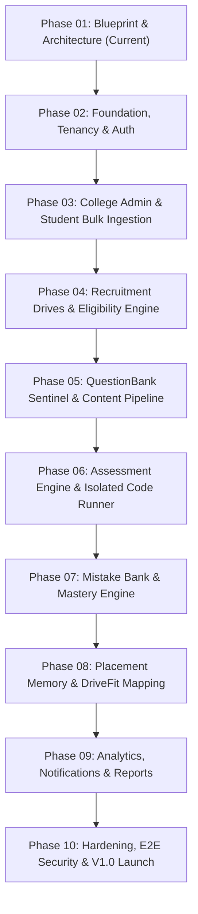

# Development Roadmap & Phase Gate Specifications — UrPlaced V1.0

**Product:** UrPlaced — Multi-College Placement Preparation & Management SaaS  
**Phase:** 01 — Product Blueprint & Architecture  
**Status:** Approved Specification  

---

## 1. Roadmap Architecture & Scope Commitment

> **Guiding Principle:** Phase numbers describe implementation sequencing, **not** product release versions.  
> 100% of the agreed V1.0 scope defined in the Product Requirements Document is systematically mapped across Phases 02 through 10. No agreed core capability is deferred to V2.0.

---

## 2. Phase-by-Phase Scope & Deliverables

### Phase 01: Product Blueprint & Architecture *(Current Gate)*
- **Core Scope:** Comprehensive specification of requirements, workflows, scoped RBAC, data model, threat modeling, service contracts, test strategy, ADRs, design system tokens, and phase roadmap.
- **Exit Gate:** All 11 specification artifacts approved; zero application code written.

---

### Phase 02: Core Foundation, Tenancy, Auth & Security Infrastructure
- **Core Scope:**
  - Initialize Next.js 15+ App Router, TypeScript (strict), Tailwind CSS with fixed design tokens and typography.
  - Set up PostgreSQL 16+ database with Prisma ORM and migration pipeline.
  - Implement Better Auth (email/password, verification, password reset) with Prisma integration.
  - Configure PostgreSQL Row-Level Security (RLS) with dedicated runtime role (`urplaced_app_runtime`) and transaction-scoped context (`SET LOCAL app.current_tenant_id`).
  - Establish base layout shell, navigation components, and design system primitives.
- **Entry Gate:** Phase 01 blueprint accepted.
- **Exit Gate:** Automated RLS tests pass; cross-tenant SELECT/INSERT queries blocked at database layer.

---

### Phase 03: College Administration, Student Profiles & Bulk Import
- **Core Scope:**
  - College workspace management (departments, programs, batch cohorts).
  - Student profile and academic record schemas (CGPA, backlogs, 10th/12th marks).
  - Bulk CSV ingestion worker with column mapping preview, row-level validation, duplicate detection, and downloadable error CSV reports.
  - Staff management and scoped role assignment.
- **Entry Gate:** Phase 02 auth and tenant isolation active.
- **Exit Gate:** Ingestion of 1,000-student test roster executes cleanly in < 10 seconds; malformed rows rejected with accurate error manifest.

---

### Phase 04: Recruitment Drives, Eligibility Engine & Source Provenance
- **Core Scope:**
  - Company directory, job role profiles, and recruitment drive setup.
  - Official recruitment notice upload with private storage integration and background AI field extraction (`status: needs_review`).
  - Configurable boolean eligibility rule engine (CGPA, backlogs, department restrictions).
  - Student-facing eligibility view with transparent pass/fail reason breakdowns and manual review dispute workflow.
  - Source provenance tracking across all recruitment claims.
- **Entry Gate:** Phase 03 student records established.
- **Exit Gate:** Eligibility engine accurately classifies test cohort into `ELIGIBLE`, `DISQUALIFIED`, and `NEEDS_REVIEW` with human-readable rationale.

---

### Phase 05: QuestionBank Sentinel (Authoring, Review & Versioning)
- **Core Scope:**
  - QuestionBank Sentinel authoring UI for MCQ, MSQ, Numeric, and Coding questions.
  - Automated pre-commit quality checks: answer-key verification, near-duplicate text similarity warning, and topic/difficulty tagging.
  - Immutable versioning (`QuestionVersion`) and Question Set packaging (`QuestionSetVersion`).
  - Licensing and tenant isolation controls (college-private by default).
- **Entry Gate:** Phase 02 security infrastructure.
- **Exit Gate:** Edits to published questions create new version numbers without altering existing snapshots.

---

### Phase 06: Assessment Engine, Server Timing, Resilient Autosave & Code Runner
- **Core Scope:**
  - Timed and untimed assessment scheduling and cohort assignments.
  - Server-authoritative timer enforcement (client clock tampering has zero effect).
  - Resilient autosave queue with monotonic sequence numbers and offline retry buffer.
  - Server-side scoring engine and post-test review policy controls.
  - Isolated code execution adapter (Judge0 / nsjail) with 2s CPU limit, 256MB RAM cap, and zero network egress.
- **Entry Gate:** Phase 05 question set versioning.
- **Exit Gate:** Assessment autosave withstands simulated 45-second network outage; malicious code submissions terminated safely by sandbox.

---

### Phase 07: Personal Mistake Bank & Mistake-to-Mastery Revision Engine
- **Core Scope:**
  - Automated ingestion of incorrect, skipped, and flagged questions into student's personal Mistake Bank.
  - Preservation of original attempt context, wrong response, correct key, and detailed explanation.
  - Spaced revision scheduler based on mistake age and frequency.
  - Mastery retest generator serving *new, isomorphic questions* (preventing memorization).
  - Verifiable mastery thresholds (e.g., 2 consecutive correct passes).
- **Entry Gate:** Phase 06 assessment completion engine.
- **Exit Gate:** Mistake retest accurately serves unseen questions on the same skill; mastery state transitions only upon genuine retest success.

---

### Phase 08: Placement Memory, DriveFit Requirement Mapping & Training Management
- **Core Scope:**
  - Historical drive archives and moderated candidate debrief collection.
  - Year-over-year drive requirement comparison diffs.
  - DriveFit requirement-to-skill mapping engine evaluating student skill evidence against role profiles.
  - Actionable preparation checklists and topic gap recommendations.
  - Training workshop scheduling, attendance tracking, and structured peer-practice coordination.
- **Entry Gate:** Phase 04 drives, Phase 06 assessments, Phase 07 skill evidence.
- **Exit Gate:** DriveFit engine accurately identifies missing skill evidence for registered candidates.

---

### Phase 09: Institutional & Student Analytics, Notifications & Export Services
- **Core Scope:**
  - Student personal readiness dashboard (accuracy by topic, velocity, mistake resolution).
  - College & placement head analytics: cohort readiness indices, department heatmaps, and before/after training impact comparisons.
  - In-app notification center and transactional email dispatch.
  - Secure CSV/Excel report exports (protecting private student mistake logs).
  - Immutable audit log query interface for compliance and security events.
- **Entry Gate:** Data generation across Phases 03–08.
- **Exit Gate:** Before/after training score comparison computes statistical delta; exports complete in < 3 seconds.

---

### Phase 10: Production Hardening, Audit Verification, E2E Security Testing & V1.0 Release
- **Core Scope:**
  - Full automated cross-tenant security audit test execution (100% pass on Allow/Deny matrix).
  - Disaster recovery drills: database restore from PITR WAL logs and object store validation.
  - Comprehensive performance profiling: database query indexing, connection pool stress testing, and lighthouse accessibility auditing.
  - Final documentation, operator runbooks, and V1.0 release sign-off.
- **Entry Gate:** All functional modules (Phases 02–09) integrated.
- **Exit Gate:** Zero security vulnerabilities, zero cross-tenant leakages, WCAG 2.1 AA compliance verified, production deployment ready.
