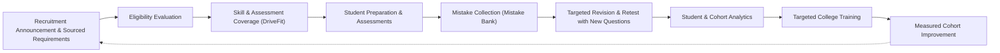

# Product Requirements Document (PRD) — UrPlaced V1.0

**Product:** UrPlaced — Multi-College Placement Preparation & Management SaaS  
**Release Target:** Complete, Integrated V1.0  
**Phase:** 01 — Product Blueprint & Architecture  
**Status:** Approved Specification  

---

## 1. Product Definition & Vision

**UrPlaced** is an enterprise multi-tenant Software-as-a-Service (SaaS) platform bridging the operational divide between college placement-cell administration and company/role-specific student preparation.

College placement cells currently rely on fragmented spreadsheets, ad-hoc messaging channels, and disconnected generic aptitude sites. Students study generic question pools disconnected from actual company recruitment patterns, while placement officers lack real-time visibility into skill readiness, eligibility compliance, and historical hiring trends.

UrPlaced integrates these operations into a unified, evidence-driven platform:
- **Placement Officers** configure actual recruitment drives, eligibility rules, sourced company requirements, vetted question banks, and timed/untimed assessments.
- **Students** view tailored opportunities, discover exact eligibility breakdowns, engage in targeted skill preparation, take server-scored assessments, analyze mistakes in a dedicated Mistake Bank, and achieve validated skill mastery.
- **Placement Leadership & Faculty** receive granular, cohort-level evidence reports on skill gaps and training effectiveness.

### Core Product Loop


---

## 2. Product Principles & Explicit Anti-Goals

### Product Success Principle
> **Measure actual product use and verifiable learning evidence—not feature count or raw question-bank size.**  
> Never claim a student has a specific probability of placement unless a separately validated, statistically grounded empirical model supports that claim. Mock scores reflect mock performance; they are not hiring guarantees.

### What UrPlaced Is NOT (Explicit Anti-Goals)
1. **Not a Generic Aptitude Drill Site:** Content is strictly organized around company intelligence, role profiles, proven historical recruitment rounds, and measurable skill mastery.
2. **Not a College ERP:** UrPlaced does not handle fee payments, hostel allocations, timetable scheduling, or broad academic grading. It synchronizes only the academic metadata necessary for placement eligibility.
3. **Not a Security SIEM/Monitoring Tool:** While it records robust audit logs for administrative compliance, it is an educational placement operations platform.
4. **Not an Employer ATS Replacement:** UrPlaced equips colleges and students for recruitment; it does not replace the employer's internal applicant tracking, interviewing, or hiring systems.
5. **Not a Placement Guarantee Engine:** No artificial "placement odds" or unvalidated likelihood predictions may ever be presented to students or colleges.

---

## 3. Target User Personas & Scenarios

| Persona | Role | Primary Goals & Responsibilities | Pain Points Solved |
| :--- | :--- | :--- | :--- |
| **Platform Super Admin** | Global SaaS Operator | Tenant onboarding, subscription limit administration, system health monitoring, audited emergency support. | Uncontrolled tenant sprawl; inability to troubleshoot tenant health securely. |
| **Placement Head / Officer** | Institution Administrator | Drive setup, eligibility rule definition, staff delegation, cohort oversight, official institution reports. | Manual spreadsheet validation; student eligibility disputes; no visibility into preparation quality. |
| **Placement Coordinator / Staff** | Operational Staff | Student bulk CSV import, question review, assessment scheduling, attendance tracking. | High error rates during student registration; unmoderated questions; manual assessment marking. |
| **Trainer / Faculty** | Learning Specialist | Assigned cohort skill drills, topic-specific practice creation, before/after training comparison. | Lack of data on student weakness areas; disconnected training sessions. |
| **Student** | Candidate | View matching drives, understand eligibility status, practice relevant skills, master mistake areas, track progress. | Generic prep without company context; no systematic way to learn from mistakes; lack of transparency in eligibility. |

---

## 4. Complete V1.0 Functional Scope

Every capability below is strictly included in the V1.0 release baseline. Implementation occurs across Phases 02–10 without deferral:

1. **Multi-College Tenant Isolation:** Logical and database-level multi-tenancy guaranteeing that data from College A is strictly inaccessible to College B.
2. **Role-Based Access Control (RBAC):** Scoped permissions for Super Admin, Placement Head, Placement Coordinator/Staff, Trainer/Faculty, and Student.
3. **Student Profile & Cohort Management:** Validated bulk CSV/spreadsheet imports with pre-commit preview, row-level error reporting, batch/branch/department tagging, and academic history tracking.
4. **Recruitment Drive & Role Engine:** Comprehensive drive creation (company, role, stipend/CTC, location, dates, rounds, selection criteria).
5. **Configurable Eligibility Engine:** Boolean and rule-based evaluation (CGPA, backlogs, department, 10th/12th percentages) with transparent student-facing reason codes and manual review workflows for missing data.
6. **Company Intelligence & Sourced Requirements:** Document uploads for official notices with AI-assisted field extraction (requiring human confirmation), provenance tracking, and uncertainty tagging.
7. **DriveFit Coverage Engine:** Automated requirement-to-skill mapping comparing drive requirements against student evidence, highlighting preparation gaps.
8. **QuestionBank Sentinel:** Quality-controlled question authoring, bulk CSV/PDF import, pre-commit validation, duplicate/near-duplicate detection, answer-key checks, topic/difficulty taxonomy, and immutable versioning.
9. **Multi-Modal Practice Questions:** Support for Single Best Answer (MCQ), Multiple Select (MSQ), Numeric/Short Answer, and Programming questions.
10. **Isolated Code Execution Sandbox Adapter:** Safe evaluation of student code submissions (Python, Java, C++, JavaScript) with strict CPU, memory, timeout, and network isolation.
11. **Assessment Delivery Engine:** Timed and untimed assessments, resilient background autosave, server-authoritative countdowns, server-side scoring, and controlled post-test review windows.
12. **Domain-Specific Practice Modules:** Quantitative Aptitude, Logical Reasoning, Verbal Ability, Technical/Core Engineering, Programming, and basic HR/Behavioral/GD prep guidelines.
13. **Resume-Informed Technical Practice:** Private resume parsing extracting key technical skills into editable student profiles for personalized drill recommendations.
14. **Personal Mistake Bank:** Automated capture of incorrect, skipped, and flagged questions preserving the exact attempt snapshot, answer key, and explanation.
15. **Mistake-to-Mastery Revision Engine:** Scheduled spaced review and retesting with *new, isomorphic questions* rather than repeating memorized answers.
16. **Placement Memory:** Institutional archive of historical drives, moderated student candidate reports, round-by-round question sets, and year-over-year drive comparisons.
17. **Institutional & Student Analytics:** Real-time dashboards, cohort readiness indices, before/after training assessment comparisons, audit logging, and CSV exports.

---

## 5. Explicit Exclusions (Deferred Beyond V1.0)

To maintain architectural focus and high engineering quality, only two complex features are explicitly deferred:
1. **AI Mock-Interview Avatars:** Real-time animated 3D/video conversational avatars. (V1.0 provides structured behavioral questions, rubric guides, and self-reflection prompts).
2. **Complex Live Audio/Video Group Discussion Rooms:** Real-time WebRTC multi-party video conferencing. (V1.0 provides GD topics, role briefs, timing frameworks, and structured peer-practice scheduling).

---

## 6. V1.0 Unresolved Business Choices & Baseline Defaults

Where business policies remain flexible, V1.0 adopts the following production-safe defaults:
- **Student Account Binding:** Student accounts are strictly bound to a participating college tenant. No independent consumer/public self-sign-up is permitted in V1.0.
- **Tenant Billing & Plans:** Manual tenant plan limits administered by the Platform Super Admin. Automated credit card/Stripe billing is deferred until college procurement models are finalized.
- **Question Sharing Across Colleges:** Question banks are private to the owning college by default. Cross-college sharing is strictly opt-in and requires explicit licensing/provenance verification.
- **Provider Decoupling:** AI providers, private object storage, email delivery, and code sandboxes are accessed through abstracted service interfaces configured via environment variables.

---

## 7. User Stories & Acceptance Criteria

### Epics Overview

```
├── Epic 1: Tenancy & Identity Management
├── Epic 2: Student Administration & Bulk Data Ingestion
├── Epic 3: Recruitment Drive & Transparent Eligibility
├── Epic 4: QuestionBank Sentinel & Quality Assurance
├── Epic 5: Resilient Assessment Engine & Isolated Code Runner
├── Epic 6: Mistake Bank & Mastery Engine
├── Epic 7: Placement Memory & Drive Intelligence
└── Epic 8: Institution Analytics & Training Oversight
```

### Epic 1: Tenancy & Identity Management
- **US-1.1:** As a Super Admin, I can create a new college tenant, set seat limits, and appoint an initial Placement Head so that the institution can begin onboarding.
  - *Acceptance:* College record is created with slug, domain restrictions, and active status. Admin credentials generate an invitation token.
- **US-1.2:** As any user, my session must securely enforce my tenant context on every request, denying any cross-tenant data access.
  - *Acceptance:* Attempting to access resource ID belonging to Tenant B while authenticated in Tenant A yields HTTP 404/403 with audit alert.

### Epic 2: Student Administration & Bulk Data Ingestion
- **US-2.1:** As a Placement Coordinator, I can upload a 1,000+ row student roster CSV, preview mapped columns, and view row-by-row syntax/duplicate validation before committing.
  - *Acceptance:* System rejects malformed rows, highlights duplicates against existing roll numbers, and produces a downloadable CSV of errors. Valid rows commit in a single transaction.

### Epic 3: Recruitment Drive & Transparent Eligibility
- **US-3.1:** As a Placement Head, I can configure a drive with multiple criteria (CGPA >= 7.5, no active backlogs, CS/IT departments only) and run an eligibility evaluation.
  - *Acceptance:* The engine evaluates all students, returning `eligible`, `not_eligible`, or `needs_review` with structured human-readable reasons (e.g., "Active backlogs exceed maximum allowed (1 > 0)").
- **US-3.2:** As a Student, I can see all upcoming drives and my eligibility status with transparent explanations for any disqualification or missing information.
  - *Acceptance:* Students cannot see internal notes, but see exact criteria checks passed/failed and can request manual review if data is outdated.

### Epic 4: QuestionBank Sentinel & Quality Assurance
- **US-4.1:** As Staff, I can create or import questions with automated checks for missing keys, duplicate question text, and missing topic tags.
  - *Acceptance:* Pre-commit preview catches identical questions via text hashing/similarity. Questions remain in `draft` until reviewed and approved by authorized staff.
- **US-4.2:** As an Assessment Creator, adding an approved question set to an assessment creates an immutable snapshot.
  - *Acceptance:* Future edits to the master question bank do not alter questions or answer keys in past completed or in-progress assessment snapshots.

### Epic 5: Resilient Assessment Engine & Isolated Code Runner
- **US-5.1:** As a Student, I can take a timed assessment with reliable autosave such that closing the browser or disconnecting briefly does not lose my responses.
  - *Acceptance:* Responses autosave every 15 seconds and on option select. Timer is server-authoritative; client clock adjustments have no effect.
- **US-5.2:** As a Student, when I submit code, it is evaluated in an isolated runner with time and memory constraints.
  - *Acceptance:* Infinite loops or malicious commands (`fork bomb`, filesystem writes, network sockets) are terminated cleanly without affecting the application server.

### Epic 6: Mistake Bank & Mastery Engine
- **US-6.1:** As a Student, any question I answer incorrectly, skip, or flag for review is automatically cataloged in my personal Mistake Bank with its attempt context.
  - *Acceptance:* Mistake entry preserves original question snapshot, student's wrong answer, correct answer, explanation, and tags.
- **US-6.2:** As a Student, I can trigger a targeted revision retest that serves new questions on the same skill/topic.
  - *Acceptance:* Mastery is updated only when the student successfully answers *unseen* isomorphic questions meeting the defined mastery threshold.

### Epic 7: Placement Memory & Drive Intelligence
- **US-7.1:** As a Placement Officer, I can view historical hiring records for a company (past rounds, question sets, candidate interview reports) to calibrate current drive prep.
  - *Acceptance:* Historical records clearly tag source provenance (official notice vs candidate-reported vs AI-extracted) and moderation state.

### Epic 8: Institution Analytics & Training Oversight
- **US-8.1:** As a Placement Head, I can view cohort-level analytics showing skill gaps across departments and track before-and-after assessment performance for training sessions.
  - *Acceptance:* Dashboard displays aggregate accuracy by topic, drive readiness distribution, and exportable CSV reports without leaking private student mistake banks.
