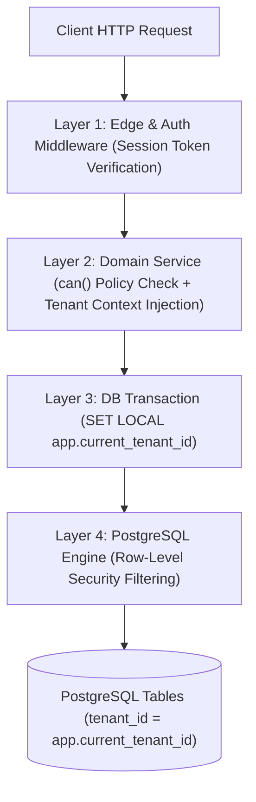

# Security, Tenant Isolation & Threat Mitigation Specification — UrPlaced V1.0

**Product:** UrPlaced — Multi-College Placement Preparation & Management SaaS  
**Phase:** 01 — Product Blueprint & Architecture  
**Status:** Approved Specification  

---

## 1. Security Philosophy: Multi-Layered Defense-in-Depth

Tenant isolation in UrPlaced is a **launch-blocking foundational invariant**, not a post-release enhancement. 

A failure in application-level middleware must never result in cross-tenant data leakage. Security is enforced through five independent, overlapping layers:
1. **Edge & Transport:** Strict TLS 1.3, CSP headers, rate-limiting, and signed cookies.
2. **Domain Service Authorization:** Server-side session verification, scoped RBAC policy checks, and tenant ID injection.
3. **Database Row-Level Security (RLS):** Kernel-level PostgreSQL isolation via non-bypassable RLS policies.
4. **Isolated Storage Partitioning:** Object-storage keys prefixed by tenant UUIDs accessed exclusively via ephemeral, pre-signed URLs.
5. **Sandboxed Code Execution:** Isolated, unprivileged container sandboxes without host filesystem or network access.



---

## 2. PostgreSQL Row-Level Security (RLS) Implementation Plan

### 1. Separation of Database Roles
To prevent privilege escalation, UrPlaced enforces a strict separation between migration roles and runtime application roles:

| Database Role | Privileges | RLS Status | Usage |
| :--- | :--- | :--- | :--- |
| `urplaced_migration_role` | `SUPERUSER` or `CREATEROLE`, Table Owner | `BYPASSRLS` | Prisma schema pushes, DDL migrations, CI pipeline setup. **Never used in application web servers.** |
| `urplaced_app_runtime` | `SELECT`, `INSERT`, `UPDATE`, `DELETE` on tables | **Subject to RLS (`NOBYPASSRLS`)** | Next.js server connection pool and background worker runtime. |

### 2. Transaction-Scoped Context Setting (`SET LOCAL`)
Every database interaction running under the runtime role must set the tenant context within the active transaction. Using `SET LOCAL` guarantees that the context automatically resets when the transaction commits or rolls back, preventing connection-pool contamination across pooled connections:

```sql
-- Executed inside BEGIN ... COMMIT transaction block
SET LOCAL app.current_tenant_id = 'c7a4e612-4f32-4e89-8d9b-891d4e0b512a';
SET LOCAL app.current_user_id = 'f1b9c345-21de-4890-a123-456789abcdef';
```

### 3. Canonical RLS Policy Template
Applied to all tenant-scoped business tables (e.g., `student_profiles`, `recruitment_drives`, `questions`, `assessment_attempts`):

```sql
-- Enable and FORCE RLS on the table (ensuring even table owners obey RLS if enabled)
ALTER TABLE student_profiles ENABLE ROW LEVEL SECURITY;
ALTER TABLE student_profiles FORCE ROW LEVEL SECURITY;

-- Select Policy: Restrict read to active tenant context
CREATE POLICY tenant_isolation_select_policy ON student_profiles
    FOR SELECT
    USING (
        tenant_id = NULLIF(current_setting('app.current_tenant_id', true), '')::UUID
    );

-- Insert Policy: Guarantee tenant_id matches the session tenant context
CREATE POLICY tenant_isolation_insert_policy ON student_profiles
    FOR INSERT
    WITH CHECK (
        tenant_id = NULLIF(current_setting('app.current_tenant_id', true), '')::UUID
    );

-- Update Policy: Prohibit changing tenant_id or modifying outside rows
CREATE POLICY tenant_isolation_update_policy ON student_profiles
    FOR UPDATE
    USING (
        tenant_id = NULLIF(current_setting('app.current_tenant_id', true), '')::UUID
    )
    WITH CHECK (
        tenant_id = NULLIF(current_setting('app.current_tenant_id', true), '')::UUID
    );

-- Delete Policy: Prevent cross-tenant deletions
CREATE POLICY tenant_isolation_delete_policy ON student_profiles
    FOR DELETE
    USING (
        tenant_id = NULLIF(current_setting('app.current_tenant_id', true), '')::UUID
    );
```

---

## 3. Storage Security & Resume Protection

1. **Private by Default:** All AWS S3 / Cloudflare R2 storage buckets are configured with Block Public Access enabled and default server-side encryption (AES-256).
2. **Deterministic Partitioning:** Storage keys follow the format:
   `tenants/${tenantId}/${category}/${fileUuid}_${sanitizedBasename}`
3. **Ephemeral Signed URLs:**
   - Upload URLs expire after 15 minutes and enforce `Content-Length` bounds and MIME type whitelists.
   - Download URLs for sensitive resumes or recruitment notices expire after 5 minutes.
4. **Malware & MIME Verification:** Files are verified using binary header magic bytes on upload; SVG uploads are prohibited or scrubbed of script tags.

---

## 4. Code Execution Sandbox Security

Executing untrusted student code represents a critical attack vector (potential fork bombs, cryptominers, SSRF, host filesystem theft).

### Sandboxing Requirements:
1. **Runner Isolation:** Evaluation takes place in ephemeral sandboxes (e.g. Judge0 using `nsjail` or isolated container instances on gVisor).
2. **Zero Root Privilege:** Student code executes as unprivileged user (`nobody` / UID 65534).
3. **Hard Resource Limits (Cgroups):**
   - Max Execution Time: 2.0 seconds CPU time (wall-clock timeout 5.0 seconds).
   - Max Memory: 256 MB RAM limit (OOM killer terminates runaway allocations).
   - Max File Output: 5 MB stdout/stderr limit.
   - Max Process Count (pids limit): 32 to prevent fork bombs.
4. **Complete Network Isolation:** Network namespace has all egress disabled (`--disable-net` / `ip link set lo down`). No connections to local network, VPC, or internet.
5. **No Secrets in Environment:** Runner sandboxes receive zero database credentials, API tokens, or server secrets.

---

## 5. AI Prompt Injection & Data Leakage Defenses

1. **Untrusted Document Boundary:** Sourced recruitment notices, resumes, and student debriefs are treated strictly as untrusted data inputs, never as executable instructions.
2. **Schema-Constrained Outputs:** All LLM responses are forced through structured JSON schemas validated via Zod. Free-form prompt completions are rejected.
3. **Zero PII in Generation Prompts:** When generating practice questions or explaining mistakes, student names, phone numbers, email addresses, and marks are sanitized and excluded from prompt context.
4. **Source Separation:** Prompts are structured with clear delimiter tokens (e.g., `<<<UNTRUSTED_STUDENT_SUBMISSION>>>`) to prevent prompt jailbreaks from overriding system instructions.

---

## 6. STRIDE Threat Model & Mitigation Checklist

| STRIDE Category | Threat Description | Architectural Mitigation in UrPlaced |
| :--- | :--- | :--- |
| **Spoofing** | Attacker forges session cookie or tenant ID | HttpOnly, Secure, SameSite=Lax signed session cookies; tenant resolved from DB membership, never client headers. |
| **Tampering** | Student alters assessment score or timer payload | Server-authoritative scoring; server records test start/expiry; answer keys never sent to browser. |
| **Repudiation** | Staff denies publishing drive or overriding eligibility | Append-only `audit_logs` record actor, target entity, timestamp, before/after JSON state, and IP address. |
| **Information Disclosure** | College A accesses College B's student roster or question bank | Dual-layer isolation: Domain service tenant checks + PostgreSQL RLS policies with `FORCE ROW LEVEL SECURITY`. |
| **Denial of Service** | Student runs infinite loop / fork bomb in code editor | Sandboxed runner with 2s CPU timeout, 256MB memory cap, 32 PID limit, and isolated container execution. |
| **Elevation of Privilege** | Student invokes `drives.publish` Server Action directly | Domain policy engine `can()` checks granular permissions independently on every Server Action and API route. |

---

## 7. Disaster Recovery, Backups & Rollback Runbook

1. **Automated Database Backups:** Point-In-Time Recovery (PITR) with continuous WAL archiving enabling restoration to any second in the past 30 days. Daily cold snapshot backups archived offsite.
2. **Disaster Recovery RTO & RPO:**
   - Recovery Time Objective (RTO): < 2 hours for full platform restoration.
   - Recovery Point Objective (RPO): < 5 minutes of transactional data.
3. **Migration Rollbacks:** Every Prisma DDL migration must include an audited, tested down-migration SQL script in version control.
4. **Restoration Drills:** Automated recovery verification tests executed monthly in an isolated staging environment.
