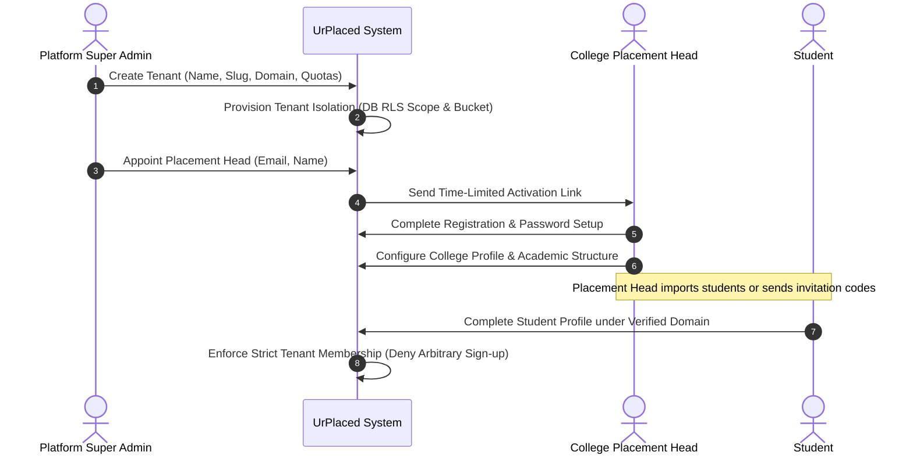
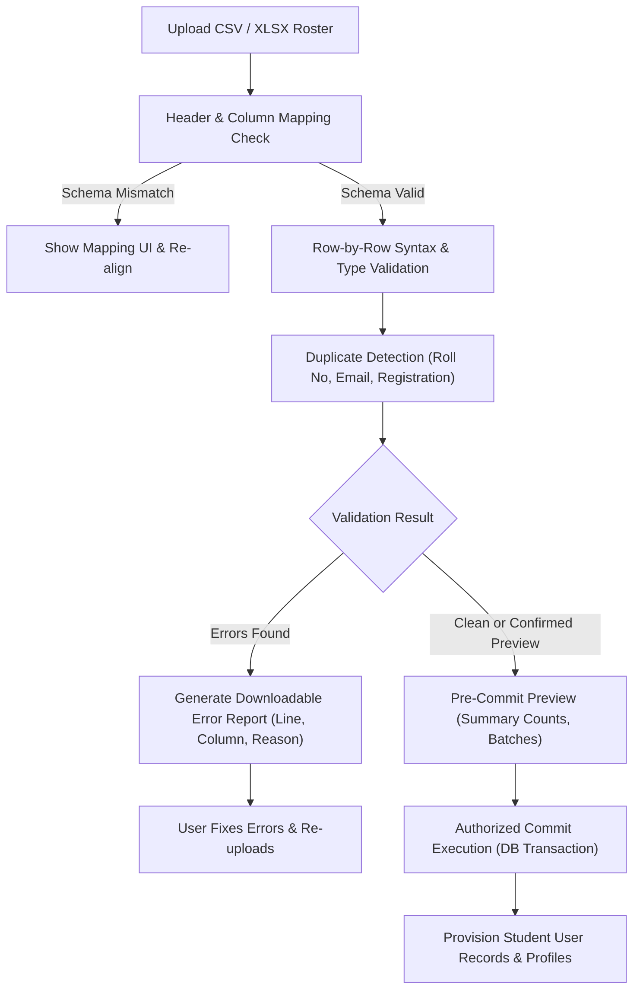
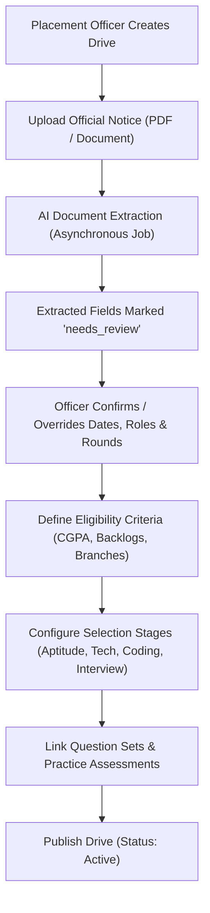
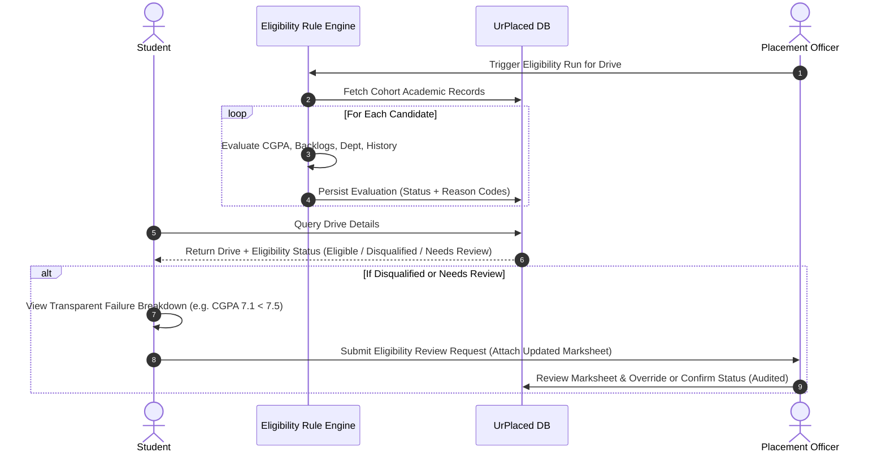
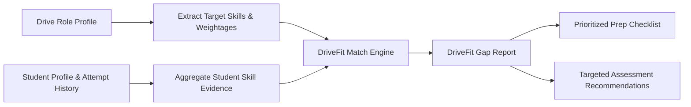
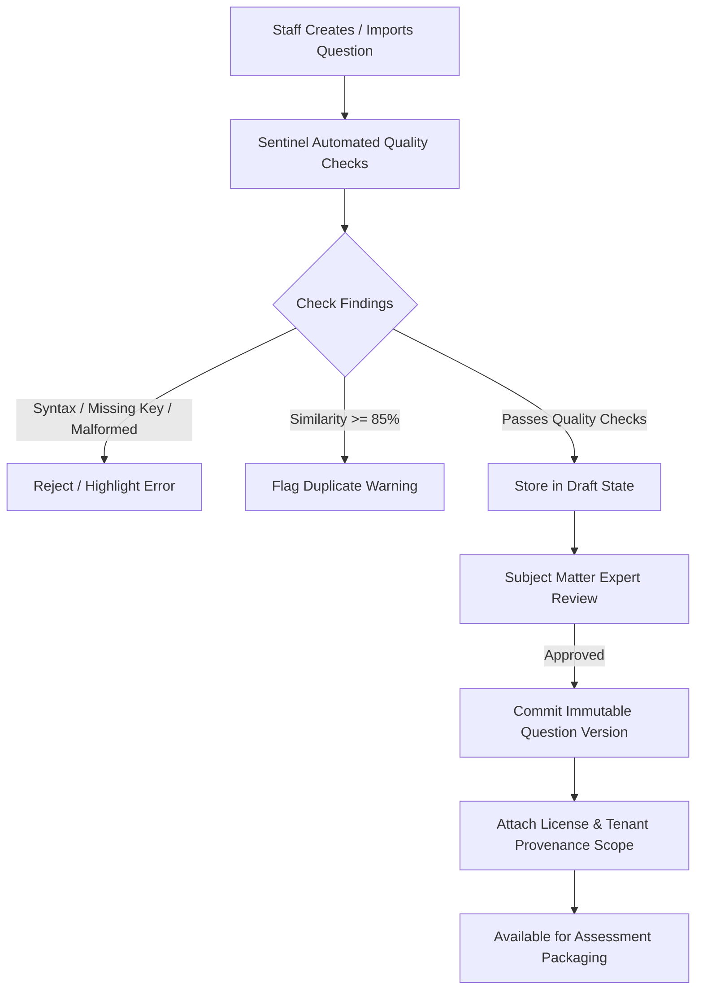
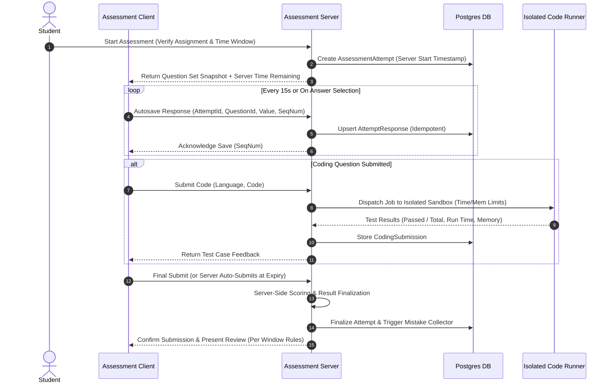

# User Journeys & Core Workflows — UrPlaced V1.0

**Product:** UrPlaced — Multi-College Placement Preparation & Management SaaS  
**Phase:** 01 — Product Blueprint & Architecture  
**Status:** Approved Specification  

---

## 1. Overview of Workflow Architecture

UrPlaced connects administrative institution operations with individualized student learning loops. This document specifies the step-by-step user journeys, state transitions, validation checkpoints, and failure recovery protocols across all 11 core product workflows.

---

## 2. Workflow 1: Tenant Onboarding & Access Provisioning



### Detailed Steps:
1. **Tenant Provisioning:** Platform Super Admin initiates creation of a new college workspace specifying institutional legal name, subdomain/slug, allowed email domains (e.g., `@campus.edu`), student seat quotas, and plan limits.
2. **Placement Head Appointment:** Super Admin designates the primary institutional administrator. The system generates an encrypted, single-use activation token with a 72-hour TTL.
3. **Workspace Initialization:** Placement Head accepts invitation, establishes credentials, and configures college metadata: departments, degree programs, graduation years (batches/cohorts), and grading scale rules (percentage vs. 10-point CGPA).
4. **Student Access Restriction:** Student self-registration requires matching the pre-approved institutional email domain and validation against the imported student roster. Open self-registration without institutional verification is strictly prohibited.

---

## 3. Workflow 2: Student Cohort Onboarding & Bulk Ingestion



### Validation Invariants & Error Handling:
- **Pre-Commit Isolation:** Uploaded files are parsed in memory / temporary private storage; no database records are committed until explicit confirmation.
- **Strict Deduplication:** System flags duplicates both within the file and against existing active database records on `roll_number` or `institutional_email`.
- **Atomic Execution:** Ingestion is executed within a database transaction scoped strictly to the current tenant ID. If any system exception occurs during commit, the entire batch rolls back.
- **Downloadable Error Manifest:** Any rejected row produces a structured CSV containing original row data alongside `error_column`, `error_type`, and `suggested_remediation`.

---

## 4. Workflow 3: Recruitment Drive Setup & Multi-Stage Configuration



### Key Stages:
1. **Notice Ingestion & Provenance:** Officer attaches the official recruitment notification file. Private object storage generates an immutable record with sha256 checksum and timestamp.
2. **AI-Assisted Field Extraction:** Background worker analyzes notice text to pre-fill key fields (company name, role title, stipend/CTC, minimum CGPA, active backlog rules, application deadline, round breakdown).
3. **Review State Enforcement:** All extracted values remain flagged as `status: needs_review`. An authorized officer must explicitly approve or edit each field before the drive can be published.
4. **Stage Configuration:** The officer builds the sequential hiring pipeline:
   - Stage 1: Online Assessment (Aptitude / Coding)
   - Stage 2: Technical Evaluation
   - Stage 3: Behavioral / HR & GD
5. **Assessment Binding:** Officer binds specific question sets or creates timed mock assessment rounds aligned with the drive's syllabus.

---

## 5. Workflow 4: Eligibility Evaluation & Transparent Dispute Resolution



### Evaluation Statuses & Reason Codes:
- `ELIGIBLE`: Student satisfies all hard criteria.
- `DISQUALIFIED`: Student fails one or more criteria. Specific reason codes are stored (e.g., `FAIL_CGPA_MINIMUM`, `FAIL_ACTIVE_BACKLOGS`, `FAIL_BRANCH_RESTRICTION`).
- `NEEDS_REVIEW`: Student record has missing fields (e.g., semester 6 CGPA not yet uploaded, pending re-evaluation).
- **Audit Requirement:** Any manual override by placement staff requires an explicit rationale and is logged in the tenant's immutable audit log.

---

## 6. Workflow 5: Recruitment Intelligence & Placement Memory

Recruitment data is classified into 6 strict information provenance tiers to guarantee integrity:

| Information Class | Source Authority | Provenance Tag | Verification Requirement |
| :--- | :--- | :--- | :--- |
| **Class 1** | Officially Published Notice | `OFFICIAL_DOCUMENT` | High (Signed document attached) |
| **Class 2** | College Placement Cell Directive | `COLLEGE_OFFICIAL` | High (Verified by Placement Head) |
| **Class 3** | Historical Drive Records (Past Years) | `HISTORICAL_VERIFIED` | Moderate (Archive matching past offers) |
| **Class 4** | Student Candidate Debrief / Report | `CANDIDATE_REPORTED` | Unverified until staff moderation |
| **Class 5** | Inferred Skill Recommendations | `INFERRED_GUIDANCE` | Clear label: "Estimated based on role patterns" |
| **Class 6** | AI-Generated Practice Questions | `AI_GENERATED` | Human review status explicitly displayed |

### Placement Memory Loop:
- Following completion of a drive, candidates submit structured round debriefs (topics covered, coding problems encountered, interview themes).
- Placement coordinators moderate and aggregate debriefs, filtering out unsubstantiated rumors.
- Future cohorts viewing the company receive historical round-by-round statistics and comparison diffs between current drive criteria and previous years.

---

## 7. Workflow 6: DriveFit Requirement-to-Skill Mapping



### DriveFit Computation:
1. **Target Profile Definition:** Each role specifies required skill competencies (e.g., `Data Structures: 40%`, `SQL/RDBMS: 30%`, `Quantitative Aptitude: 30%`).
2. **Student Evidence Vector:** Evaluated from verified assessment attempts, coding problem test suite passes, and validated coursework.
3. **Gap Identification:** System calculates skill coverage delta and renders clear actionable badges:
   - `READY`: Evidence meets or exceeds role threshold.
   - `ATTENTION_NEEDED`: Partial evidence or low accuracy on core topics.
   - `CRITICAL_GAP`: Zero attempt evidence on mandatory role requirements.

---

## 8. Workflow 7: QuestionBank Sentinel (Authoring, Review & Versioning)



### Sentinel Rules:
- **Immutable Versioning:** Editing an approved question creates a new `QuestionVersion`. Historical assessments continue referencing the exact version used at test time.
- **Answer-Key Integrity:** For MCQs, exactly one option must be marked correct; for MSQs, at least one; for numeric, range bounds must be valid; for coding, at least 3 test cases (including hidden) must be validated.
- **Tenant Scope & Licensing:** Questions remain private to the owning college unless explicitly marked `TENANT_SHARED` under a verified open content license.

---

## 9. Workflow 8: Assessment Attempt & Server-Authoritative Execution



### Security & Integrity Controls:
- **Server Clock Authority:** The client timer is purely visual. The server validates submission against `started_at + duration_minutes + grace_period (60s)`.
- **Autosave Resilience:** Responses utilize monotonic sequence numbers preventing stale network requests from overwriting newer answers.
- **Review Policy Control:** Review settings are configurable by staff:
  - `IMMEDIATE`: Solutions and explanations available upon submission.
  - `AFTER_WINDOW_CLOSES`: Solutions concealed until all cohort candidates have finished.
  - `NEVER`: High-stakes screening assessments where answers remain confidential.

---

## 10. Workflow 9: Personal Mistake Bank & Mistake-to-Mastery Revision

```mermaid
flowchart TD
    A["Assessment Finalized"] --> B["Mistake Collector Filters Responses"]
    B --> C["Incorrect Answers"]
    B --> D["Skipped / Unattempted Questions"]
    B --> E["Student-Flagged 'Review Later'"]
    C & D & E --> F["Catalog in Personal Mistake Bank"]
    F --> G["Student Reviews Original Attempt & Explanation"]
    G --> H["Trigger Revision Retest"]
    H --> I["Fetch NEW Isomorphic Questions (Same Topic & Difficulty)"]
    I --> J["Student Retest Attempt"]
    J --> K{"Retest Performance"}
    K -->|Passes Mastery Threshold (>= 2 Consec Correct)| L["Mark Topic as Mastered"]
    K -->|Fails Retest| M["Reschedule Spaced Revision (Interval: 3 Days)"]
```

### Mistake-to-Mastery Invariant:
> **True mastery requires answering new, previously unseen questions correctly.**  
> Simply re-answering a question whose explanation and key were just revealed does not grant skill mastery. The engine requires passing isomorphic questions from the Sentinel Question Bank.

---

## 11. Workflow 10: Training Sessions & Structured Peer Practice

### Institutional Training Management:
1. **Session Scheduling:** Faculty/Trainer creates a targeted training session (e.g., "Dynamic Programming Workshop" or "TCS NQT Aptitude Crash Course").
2. **Cohort Enrollment:** Specific batches or students flagged with DriveFit skill gaps are enrolled.
3. **Pre-Assessment:** Students take a diagnostic baseline test.
4. **Instruction & Attendance:** Staff records digital attendance and distributes practice question sets.
5. **Post-Assessment:** Students take a calibrated exit assessment to measure direct skill improvement.

### Structured Peer Practice (V1.0 Scope):
- Students can schedule mutual study sessions on specific topic pairs.
- System provides synchronized question sets, personal timers, and shared answer comparison post-session.
- *Notice:* Audio/video communication is conducted via external links (e.g., Google Meet); V1.0 avoids premature internal WebRTC video infrastructure.

---

## 12. Workflow 11: Institutional & Student Analytics

### Analytics Pipeline:
1. **Student Personal Analytics:**
   - Accuracy by topic and cognitive difficulty.
   - Velocity (average time spent per question type).
   - Mistake Bank resolution velocity (open vs. mastered errors).
   - DriveFit readiness progress for bookmarked companies.
2. **College & Cohort Dashboards:**
   - Real-time drive eligibility counts and department-wise participation.
   - Aggregate topic weakness heatmaps across branches.
   - Training ROI: Statistical before-and-after accuracy comparisons across training cohorts.
3. **Data Governance & Export:**
   - Placement officers can export verified placement reports and assessment ledgers in standardized CSV/Excel formats.
   - Individual student Mistake Banks remain private to the student and are excluded from institutional exports to preserve psychological safety.
