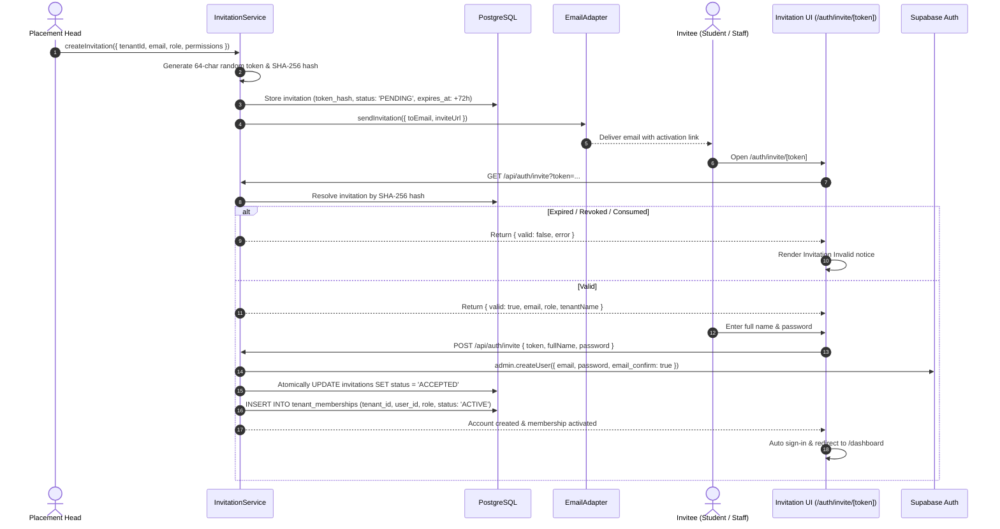

# Authentication & Identity Lifecycle Flows — UrPlaced V1.0

**Product:** UrPlaced — Multi-College Placement Preparation & Management SaaS  
**Phase:** 03 — Authentication & Multi-College Infrastructure  
**Status:** Approved Specification & Implementation  

---

## 1. Overview & Architecture

UrPlaced separates credential/session management from institutional authorization:
- **Identity & Session Management:** Managed via **Supabase Auth** (`auth.users`, secure HttpOnly cookies, session refresh via `@supabase/ssr`).
- **Institutional Multi-Tenancy & Authorization:** Managed via **UrPlaced Application Schema** (`tenants`, `profiles`, `tenant_memberships`, `invitations`, `audit_logs`).

Client-supplied roles, tenant IDs, or profile fields are untrusted. Every protected server action, route handler, and page resolves the authenticated user ID from Supabase Auth and checks active tenant membership in the database.

---

## 2. Authentication Flow 1: Email/Password Sign-In

```mermaid
sequenceDiagram
    autonumber
    actor U as User
    participant UI as Sign-In Client (/auth/signin)
    participant SB as Supabase Auth Service
    participant MW as Next.js Middleware
    participant Svc as AuthService
    participant DB as Supabase PostgreSQL

    U->>UI: Enter email & password
    UI->>SB: signInWithPassword({ email, password })
    alt Invalid Credentials
        SB-->>UI: AuthApiError
        UI->>UI: Display generic error: "Invalid email or password."
    else Valid Credentials
        SB-->>UI: Set HttpOnly session cookies
        UI->>MW: Navigate to target destination (/dashboard)
        MW->>SB: getUser() (Session validation & token refresh)
        MW->>Svc: Resolve user profile & active memberships
        Svc->>DB: Query tenant_memberships WHERE user_id = auth.uid()
        alt Suspended Tenant
            Svc-->>UI: Redirect to /auth/tenant-suspended
        alt Suspended Membership
            Svc-->>UI: Redirect to /auth/membership-suspended
        alt Multiple Active Workspaces
            Svc-->>UI: Redirect to /dashboard/select-tenant
        else Single Active Workspace
            Svc-->>UI: Redirect to /dashboard
        end
    end
```

### Negative Scenarios & Defenses:
- **Unknown Email / Failed Password:** Returns identical generic error messaging to prevent user enumeration.
- **Unverified Account:** Supabase Auth denies session generation until email is confirmed.
- **Suspended Tenant / Membership:** Middleware and server components evaluate database state immediately; existing valid sessions are blocked from tenant features without waiting for token expiry.

---

## 3. Authentication Flow 2: Invitation-Based Onboarding & Activation

V1.0 is strictly invitation-based for all college-affiliated accounts. Public self-signup is disabled.



### Security & Integrity Controls:
- **Hash-at-Rest:** Raw invitation tokens are never stored in the database. Only the SHA-256 hash is persisted.
- **Atomic Single-Use:** The database update (`status = 'ACCEPTED' WHERE status = 'PENDING'`) prevents race conditions and replay attacks.
- **Email Binding:** The invitee account's email must match the invitation's normalized email address.

---

## 4. Authentication Flow 3: Password Recovery

1. **Request:** User enters email at `/auth/forgot-password`.
2. **Non-Enumerating Response:** The UI displays a success confirmation regardless of whether the email exists, preventing timing and oracle attacks.
3. **Dispatch:** Supabase Auth generates a short-lived recovery token and sends a magic link pointing to `/auth/reset-password`.
4. **Code Exchange:** When opened, the recovery code is exchanged securely via `@supabase/ssr` cookies.
5. **Update:** The user specifies a new password (min 8 chars); `supabase.auth.updateUser({ password })` updates the credential and invalidates old sessions.

---

## 5. Authentication Flow 4: Sign-Out & Session Revocation

- Triggered via Server Action in `src/app/dashboard/page.tsx`:
  ```typescript
  async function handleSignOut() {
    "use server";
    const supabase = await createClient();
    await supabase.auth.signOut();
    redirect("/auth/signin");
  }
  ```
- **Session Cleanup:** Clears all authentication cookies and invalidates the session server-side.
- **Browser History Protection:** Protected pages enforce `export const dynamic = 'force-dynamic'` and `Cache-Control: no-store`, preventing browser back-button caching of sensitive student data.
