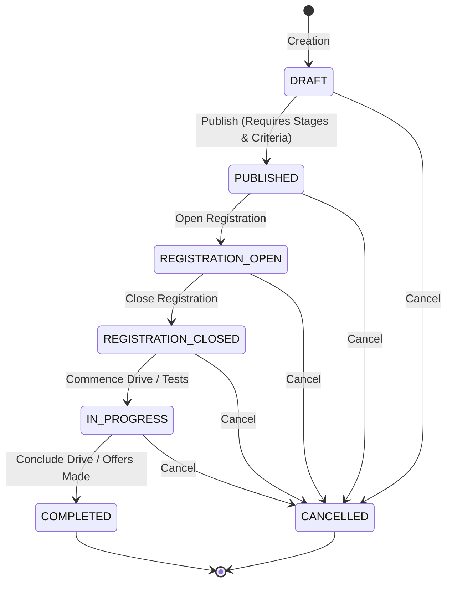

# Phase 04: Recruitment Drive Lifecycle & Eligibility Engine

## 1. Recruitment Drive State Machine

Recruitment drives model campus hiring events from initial announcement to final offers. The lifecycle enforces a deterministic finite state machine implemented in `src/modules/recruitment-drives/services/drive-service.ts`.

### 1.1 State Machine Diagram



### 1.2 Transition Matrix and Validation Invariants

| From State | To State | Mandatory Invariants |
| :--- | :--- | :--- |
| `DRAFT` | `PUBLISHED` | Must have: (1) At least one defined pipeline stage (`drive_stages`), (2) Defined eligibility criteria (`drive_eligibility_criteria`), (3) Valid role title and recruitment type. |
| `PUBLISHED` | `REGISTRATION_OPEN` | Drive must be active; registration window open. Eligible students can now submit applications. |
| `REGISTRATION_OPEN` | `REGISTRATION_CLOSED` | Registration window ended or closed manually by placement coordinator. No new student applications accepted. |
| `REGISTRATION_CLOSED` | `IN_PROGRESS` | Shortlisting commences; candidates advance through assessment and interview stages. |
| `IN_PROGRESS` | `COMPLETED` | All stages completed and final placement offers recorded. |
| Any (except `COMPLETED`, `CANCELLED`) | `CANCELLED` | Drive aborted by placement team; applications preserved for auditing. |

---

## 2. Deterministic Eligibility Engine

Implemented in `src/modules/eligibility/services/eligibility-engine.ts`, the eligibility engine evaluates a student's academic profile against a drive's criteria without side-effects or external network calls.

### 2.1 Criteria Evaluated

1. **CGPA Threshold (`min_cgpa`):**
   - Condition: `student.cgpa >= criteria.min_cgpa`.
   - Missing data behavior: If `student.cgpa` is null, returns `NEEDS_REVIEW` with reason `CGPA not recorded`.
2. **Class 10th Percentage (`min_tenth_percentage`):**
   - Condition: `student.tenth_percentage >= criteria.min_tenth_percentage`.
3. **Class 12th Percentage (`min_twelfth_percentage`):**
   - Condition: `student.twelfth_percentage >= criteria.min_twelfth_percentage`.
4. **Active Backlogs (`max_active_backlogs`):**
   - Condition: `student.active_backlogs <= criteria.max_active_backlogs`.
5. **History of Backlogs (`max_history_backlogs`):**
   - Condition: `student.history_of_backlogs <= criteria.max_history_backlogs`.
6. **Allowed Departments (`allowed_department_ids`):**
   - Condition: If list is non-empty, `criteria.allowed_department_ids.includes(student.department_id)`.
7. **Allowed Graduation Years (`allowed_graduation_years`):**
   - Condition: If list is non-empty, `criteria.allowed_graduation_years.includes(student.graduation_year)`.
8. **Placed Student Re-application Policy (`allow_placed_students`):**
   - If `criteria.allow_placed_students === false` and `student.placement_status === 'PLACED'`, marked `INELIGIBLE`.
9. **Opted-Out Policy (`allow_opted_out_students`):**
   - If `criteria.allow_opted_out_students === false` and `student.placement_status === 'OPTED_OUT'`, marked `INELIGIBLE`.
10. **Student Status Check:**
    - If `student.status !== 'ACTIVE'`, student is marked `INELIGIBLE`.

### 2.2 Output Contract

```typescript
export interface EligibilityEvaluationResult {
  isEligible: boolean;
  status: 'ELIGIBLE' | 'INELIGIBLE' | 'NEEDS_REVIEW';
  failedRules: string[];
  reasons: string[];
}
```

When an application is created via `CandidateService.registerCandidate()`, the evaluation is computed immediately and stored as an immutable audit snapshot in `drive_applications(eligibility_status, eligibility_reasons)`.
