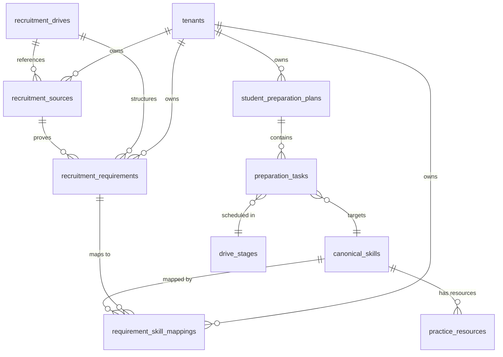

# Phase 05: DriveFit Architecture Specification

## 1. Executive Summary & Purpose

**DriveFit (Company-Specific Recruitment Intelligence)** bridges institutional recruitment data with student preparation. Rather than providing generic aptitude questions or disconnected company trivia, DriveFit connects actual recruitment drives created by college placement cells to:
1. Source-verified employer requirements and eligibility rules.
2. An explainable mapping to canonical curriculum topics and skills.
3. Available practice resources and study checklists.
4. An actionable, round-by-round student preparation planner.
5. Preparation coverage metrics (distinguished strictly from predictive placement chances).

---

## 2. Separation of Information Levels

DriveFit strictly enforces a three-level separation of recruitment information:

| Level | Scope | Authoritative Precedence | Example Data |
| :--- | :--- | :--- | :--- |
| **Drive-Specific** | Single recruitment drive for a specific college & batch | **Highest Precedence** | Official placement cell circular, drive deadline, confirmed rounds (OA, Tech, HR), college-specific eligibility criteria. |
| **Role-Specific** | Specific job profile family across campus drives | **Medium Precedence** | Software Engineer role responsibilities, required programming languages (Python, Java), frameworks. |
| **Company-Level** | General employer metadata and public career portal information | **Lowest Precedence** | Company overview, general interview guidance, public career portal FAQs. |

> [!IMPORTANT]
> A generic company hiring process never silently overwrites the confirmed rounds, criteria, or deadlines of a specific college recruitment drive. If sources conflict, the conflict is explicitly flagged for staff review.

---

## 3. Data Model & Entity Architecture

Implemented in `supabase/migrations/20261018000003_phase05_recruitment_intelligence_drivefit.sql`:

### 3.1 Composite Foreign Key Multi-Tenant Isolation
All tables enforce composite foreign keys `(tenant_id, <parent>_id)` referencing `(tenant_id, id)` on parent entities (`companies`, `recruitment_drives`, `students`, `student_preparation_plans`). Cross-college data leakage is rendered structurally impossible at the PostgreSQL engine level.

### 3.2 Forced Row-Level Security (RLS)
All Phase 05 tables have Row Level Security enabled and forced:
- `is_tenant_staff(tenant_id)` has full CRUD access to sources, requirements, mappings, and experience reports.
- Students have read access only to `VERIFIED` and `is_published_to_students = true` requirements, and full ownership of their own `student_preparation_plans` and `preparation_tasks`.
- Unverified, confidential, or draft claims are never visible in student queries.
