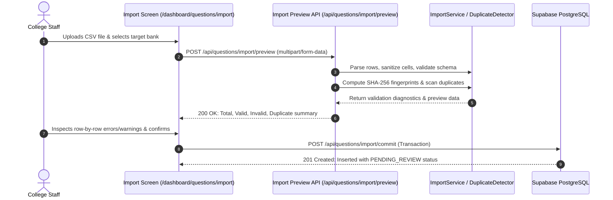

# CSV Import & Duplicate Detection Engine

## 1. Batch Import Workflow

The batch question import follows a strict three-phase sequence to prevent unverified content or structural corruption from entering the question bank.

---

## 2. Duplicate Detection Architecture

### A. Deterministic SHA-256 Fingerprinting
Exact duplicates are identified by computing a deterministic hash over normalized prompt content and sorted option texts:

$$\text{Payload} = \text{Norm}(\text{Prompt}) + \text{":::"} + \text{Sorted}(\text{Norm}(\text{Options}))$$

$$\text{Fingerprint} = \text{SHA-256}(\text{Payload})$$

- Text normalization strips accents (NFKD), removes punctuation, converts to lowercase, and collapses whitespace.
- Permuted MCQ options produce identical fingerprints.

### B. Near-Duplicate Token Similarity
Near duplicates (paraphrased questions, minor phrasing edits) are identified using token-level and character 3-gram Jaccard similarity:

$$\text{Similarity}(A, B) = \frac{|T_A \cap T_B|}{|T_A \cup T_B|}$$

- Tokens comprise extracted words (length $> 2$) combined with overlapping character 3-grams for typo-resilient phrase matching.
- **Threshold Sensitivity**:
  - $\ge 0.75$: Candidate near-duplicate flagged for human review.
  - $\ge 0.85$: High-confidence near-duplicate alert.
  - $1.00$: Exact duplicate (fingerprint match).

---

## 3. Human Review Workflow for Duplicates

1. Candidate pairs are stored in `question_duplicate_candidates` with status `PENDING_REVIEW`.
2. Authorized staff inspect side-by-side prompt comparisons in the **Duplicate Alerts Modal**.
3. Staff can resolve candidates as:
   - `FALSE_POSITIVE`: Independent questions covering similar topics.
   - `CONFIRMED_DUPLICATE`: Redundant question; author can withdraw or merge into existing.
   - `RESOLVED`: Handled and cleared from active alerts.
