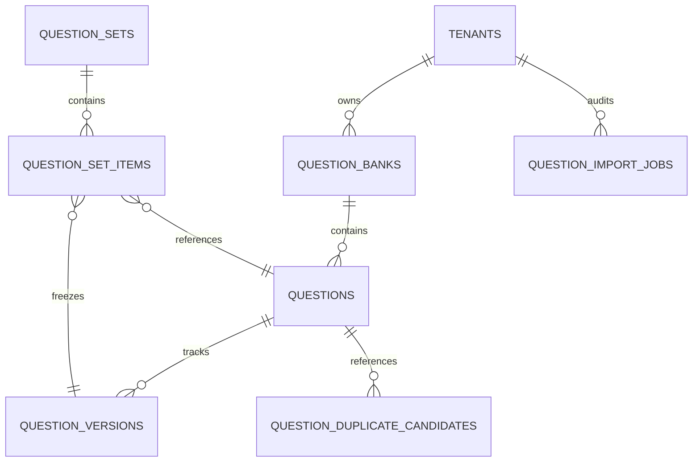

# QuestionBank Sentinel Architecture Specification

## 1. Executive Overview

**QuestionBank Sentinel** provides trustworthy, multi-modal, version-controlled question-content management for the UrPlaced multi-college placement SaaS platform.

It guarantees that all questions authored, imported, and assembled into assessment sets are structurally validated, checked for exact and near duplicates, reviewed for answer-key correctness by authorized college staff, and versioned immutably before being consumed by student preparation or live assessments.

---

## 2. Core Entities & Database Model

### Table Specifications

1. **`question_banks`**: Category-based and tenant-scoped containers (`CODING`, `APTITUDE`, `TECHNICAL_CORE`, `BEHAVIORAL`, `GENERAL`, `COMPANY_SPECIFIC`). Supports sharing policies (`COLLEGE_PRIVATE`, `EXPLICITLY_SHARED`, `GLOBAL_SHARED`).
2. **`questions`**: Stable question identity entity tracking `question_type`, `bank_id`, `current_version_id`, and `lifecycle_status` (`DRAFT`, `PENDING_REVIEW`, `APPROVED`, `PUBLISHED`, `WITHDRAWN`, `ARCHIVED`).
3. **`question_versions`**: Immutable revision snapshots containing prompt, content format, options JSON, answer key JSON, explanation, difficulty, canonical skill reference, topic tags, provenance source, licensing, review status, and deterministic SHA-256 fingerprint.
4. **`question_import_jobs`**: Auditable tracker for batch CSV imports capturing total, valid, invalid, duplicate row counts, and structural diagnostic reports.
5. **`question_duplicate_candidates`**: Stores exact fingerprint matches and text similarity candidate pairs (`similarity_score`, `detection_method`, `status`).
6. **`question_sets`**: Blueprints for assessments and practice drills supporting immutable version snapshots and locking (`is_locked = true`).
7. **`question_set_items`**: Associates question sets to specific `question_id` and immutable `version_id`, specifying sequence order, positive marks, and negative marking penalty.

---

## 3. Supported Question Types & Schemas

| Type | Structure | Answer Key Definition | Evaluation Semantics |
| :--- | :--- | :--- | :--- |
| `SINGLE_CHOICE` | Prompt + 2+ Options with stable IDs | `{ correct_option_id: string }` | Exact match with unique option ID |
| `MULTIPLE_SELECT` | Prompt + 2+ Options with stable IDs | `{ correct_option_ids: string[] }` | Full/partial match across selected options |
| `NUMERIC` | Prompt | `{ value: number, tolerance?: number }` | Value match within non-negative tolerance `[val - tol, val + tol]` |
| `SHORT_ANSWER` | Prompt | `{ rubric: string, sample_answer?: string }` | Conceptual benchmark rubric for human/AI evaluation |
| `CODING` | Prompt + Language Starter Templates | `{ test_cases: CodingTestCase[] }` | Verified against public examples and hidden edge cases |

---

## 4. Immutable Revision Invariants

1. **Stable Question Identity**: A question retains a single unique UUID (`questions.id`) across its entire lifetime.
2. **Revision Spawning**: Once a version is `PUBLISHED` or referenced by any `question_set_items`, editing that question never mutates the existing row in place. It automatically increments `version_number` and inserts a new immutable `question_versions` row.
3. **Non-Destructive Archiving**: Archiving a question or question set sets its status to `ARCHIVED` without destroying historical assessment results, attempts, or revision history.
4. **Frozen Set Snapshots**: Locking a question set (`is_locked = true`) binds each item to an immutable version ID, ensuring reproducible assessments even if the bank question is later revised.
