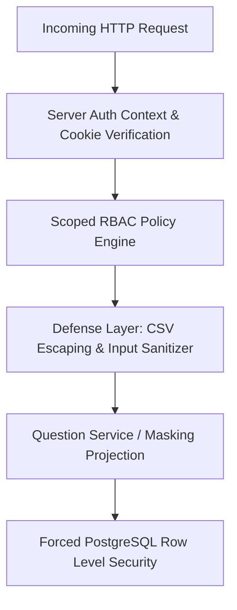

# Security Invariants & Row Level Security (RLS) Audit

## 1. Security Architecture & Threat Model

QuestionBank Sentinel safeguards sensitive assessment questions, answer keys, hidden test cases, and multi-tenant isolation through multi-layered defenses.

---

## 2. Security Invariants

### Invariant 1: Student Answer-Key and Hidden Test-Case Masking
- **Risk**: Unauthorized students inspecting network payloads or database records could cheat on assessments or practice tests.
- **Enforcement**:
  1. The API and service layer strictly sanitize version records via `QuestionService.sanitizeForStudent`.
  2. For `SINGLE_CHOICE`, `MULTIPLE_SELECT`, `NUMERIC`, and `SHORT_ANSWER`, the `answer_key` object and `explanation` are completely omitted.
  3. For `CODING` questions, hidden verification test cases are stripped, returning only public starter examples and templates.
  4. Database RLS permits students to read only `PUBLISHED` questions and published question sets.

### Invariant 2: No Auto-Publication of Unreviewed Content
- **Risk**: Low-quality, duplicate, or incorrect questions imported via CSV or generated by external sources immediately impacting student assessments.
- **Enforcement**:
  1. All authored or imported questions enter the system with `DRAFT` or `PENDING_REVIEW` lifecycle status.
  2. The `POST /api/questions/[id]/publish` endpoint enforces that `question_versions.review_status` must equal `VERIFIED_CORRECT`.
  3. Staff must explicitly inspect and confirm the answer key before publication.

### Invariant 3: CSV Formula Injection (Spreadsheet Injection) Neutralization
- **Risk**: Malicious spreadsheet formulas (`=cmd|' /C calc'`, `@SUM`, `-`, `+`, `\t`) executed when college administrators open exported CSVs in Microsoft Excel or Google Sheets.
- **Enforcement**:
  1. In `ImportService.sanitizeCell`, all cells starting with dangerous characters (`=`, `+`, `-`, `@`, `\t`, `\r`) are automatically escaped with a prepended single quote (`'`).
  2. Leading tabs and carriage returns are checked and neutralized prior to trimming.

---

## 3. PostgreSQL RLS Policies Audit

All 7 QuestionBank Sentinel tables enforce `FORCE ROW LEVEL SECURITY`:

| Table | Policy Name | Permitted Roles | Conditions |
| :--- | :--- | :--- | :--- |
| `question_banks` | `p_q_banks_staff` | Staff (`PLACEMENT_HEAD`, `STAFF`, `TRAINER`) | `is_tenant_staff(tenant_id)` full CRUD |
| `question_banks` | `p_q_banks_global_read` | All Authenticated | `sharing_policy = 'GLOBAL_SHARED' AND status = 'ACTIVE'` |
| `question_banks` | `p_q_banks_student_read` | Student | Active tenant membership & `status = 'ACTIVE'` |
| `questions` | `p_questions_staff` | Staff | `is_tenant_staff(tenant_id)` full CRUD |
| `questions` | `p_questions_student_read` | Student | `lifecycle_status = 'PUBLISHED'` and tenant membership |
| `question_versions` | `p_q_versions_staff` | Staff | `is_tenant_staff(tenant_id)` full CRUD |
| `question_versions` | `p_q_versions_student_read`| Student | `published_at IS NOT NULL` and question is `PUBLISHED` |
| `question_import_jobs`| `p_import_jobs_staff` | Staff | `is_tenant_staff(tenant_id)` |
| `question_duplicate_candidates` | `p_dup_candidates_staff` | Staff | `is_tenant_staff(tenant_id)` |
| `question_sets` | `p_q_sets_staff` | Staff | `is_tenant_staff(tenant_id)` |
| `question_sets` | `p_q_sets_student_read` | Student | `status = 'PUBLISHED'` |
| `question_set_items` | `p_set_items_staff` | Staff | `is_tenant_staff(tenant_id)` |
| `question_set_items` | `p_set_items_student_read`| Student | Question set `status = 'PUBLISHED'` |
