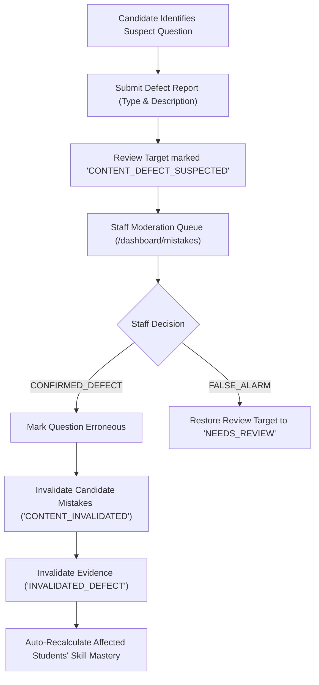

# Phase 08 — Content Defect Moderation & Assessment Fairness

## 1. Principles of Assessment Fairness

In campus placements and technical preparation, candidate frustration frequently stems from defective questions, outdated answer keys, or ambiguous phrasing.

**Core UrPlaced Rule:** Do not automatically blame the student when the content itself may be wrong.

---

## 2. Question Defect Lifecycle

### Defect Types Handled:
1. `INCORRECT_ANSWER_KEY`: Erroneous option marked correct in question version.
2. `AMBIGUOUS_PROMPT`: Missing critical constraints or conflicting problem statement.
3. `MISSING_INVALID_OPTION`: Options list is corrupted, duplicated, or missing correct choice.
4. `ERRONEOUS_EXPLANATION`: Step-by-step reasoning contradicts accepted mathematical or computer science principles.
5. `BROKEN_RUNNER_CONFIG`: Coding test case runner failed due to environment issue rather than student logic.
6. `WRONG_SKILL_MAPPING`: Question mapped to irrelevant canonical skill taxonomy.

---

## 3. Unfair Penalty Invalidation

When a defect is resolved as `CONFIRMED_DEFECT`:
- All `mistake_review_targets` for `(tenant_id, question_id, version_id)` are updated to `status = 'CONTENT_INVALIDATED'`.
- All `mastery_evidence_records` using this question version are updated to `validity_status = 'INVALIDATED_DEFECT'` with `invalidation_reason` set to the staff reviewer's notes.
- `MasteryEvaluationService.evaluateSkillMastery` runs for every affected student, restoring their verified accuracy percentage and skill badge immediately.
