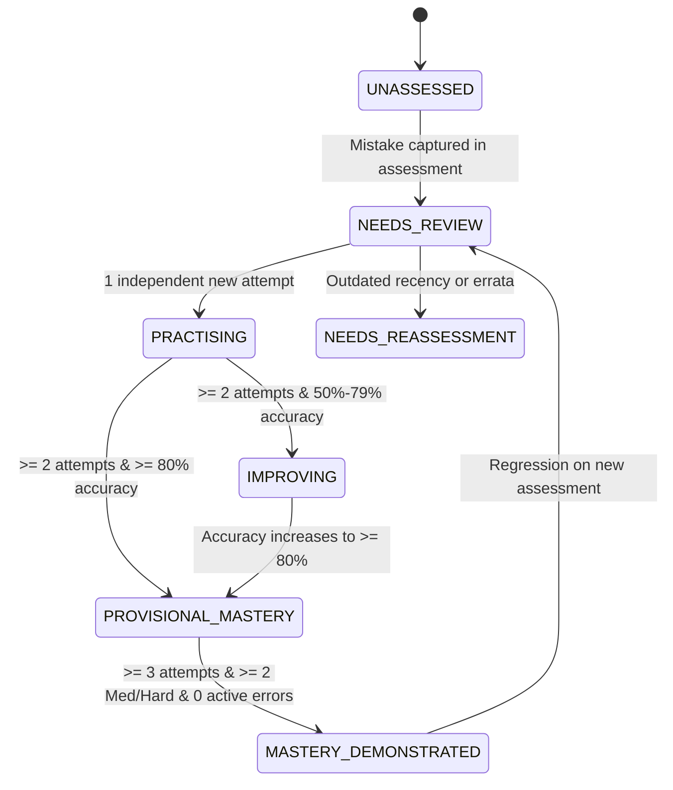

# Phase 08 — Mastery Invariants & Policy Specification

## 1. Non-Negotiable Mastery Invariant

> [!IMPORTANT]
> **Core Mastery Invariant:**
> Answering a question whose answer was already revealed can **NEVER** alone establish mastery.
> Mastery strictly requires independent, unrevealed correct answers on **NEW** approved questions covering the same canonical skill.

### Mathematical & Relational Invariant
When a student answers a practice retest drill:
$$\text{is\_new\_question} = (\text{question\_id} \neq \text{target.question\_id})$$

If $\text{is\_new\_question} = \text{false}$:
- The action records a review rehearsal and may advance the target stage from 1 to 2, but:
- It is excluded from the denominator and numerator of independent skill mastery evaluations:
$$\text{Independent Attempts} = \sum_{\text{valid}} [\text{is\_new\_question} = \text{true}]$$
$$\text{Independent Correct} = \sum_{\text{valid}} [\text{is\_new\_question} = \text{true} \land \text{is\_correct} = \text{true}]$$

---

## 2. Mastery Status Progression Hierarchy

The student's skill proficiency is evaluated deterministically using this exact state machine:

### Exact Thresholds:

| Status | Independent Attempts | Accuracy % | Additional Criteria |
| :--- | :--- | :--- | :--- |
| `UNASSESSED` | $0$ | $0\%$ | No mistakes or attempts on this skill |
| `NEEDS_REVIEW` | Any | $< 50\%$ | Active mistakes or sub-50% accuracy |
| `PRACTISING` | $1$ | Any | Fewer than 2 independent trials completed |
| `IMPROVING` | $\ge 2$ | $50\% - 79\%$ | Positive learning trend demonstrated |
| `PROVISIONAL_MASTERY` | $\ge 2$ | $\ge 80\%$ | Strong performance on 2 independent new questions |
| `MASTERY_DEMONSTRATED` | $\ge 3$ | $\ge 80\%$ | $\ge 2$ Medium/Hard items and $0$ active review targets |
| `NEEDS_REASSESSMENT` | Any | N/A | Defect invalidation or retention policy decay |
