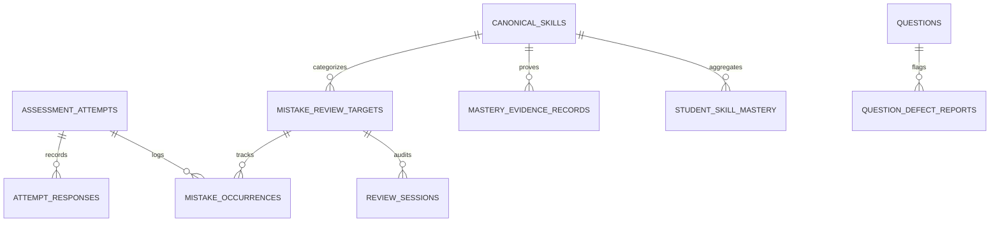

# Phase 08 — Mistake Bank & Mistake-to-Mastery Engine Architecture

## 1. Executive Summary

Phase 08 introduces the **Mistake Bank & Mistake-to-Mastery Engine** for UrPlaced. Instead of merely recording incorrect answers as static test logs, this module creates an explainable, evidence-based improvement cycle:

$$\text{Attempt Evidence} \longrightarrow \text{Mistake Review Target} \longrightarrow \text{Root-Skill Association} \longrightarrow \text{Explanation Review} \longrightarrow \text{Targeted Practice} \longrightarrow \text{Scheduled Revision} \longrightarrow \text{New-Question Retest} \longrightarrow \text{Evidence-Based Skill Mastery}$$

---

## 2. Core Domain Models

### 2.1 Deduplicated Review Targets vs Granular Occurrences

To eliminate duplicate review bloat while maintaining historical audit integrity, the architecture splits mistake data into two separate relational tiers:

1. **`mistake_review_targets`**:
   - Deduplicated per `(tenant_id, student_id, question_id, version_id)`.
   - Tracks current spaced repetition stage (1–5), next due date, status, student self-reflection note, and root-cause classification.
   - Preserves earliest `first_observed_at` and latest `last_observed_at`.
2. **`mistake_occurrences`**:
   - Every individual attempt where the question was missed, skipped, or flagged.
   - Links directly to `attempt_id`, `response_id`, and stores the exact submitted payload snapshot and points awarded.
   - Enforces unique constraint on `(attempt_id, question_id)` for idempotency during scoring reruns.

---

## 3. Seven Review Classifications

Every item ingested into the Mistake Bank is categorized into one of 7 review reasons:

| Classification | Trigger Condition | Status |
| :--- | :--- | :--- |
| `INCORRECT_ANSWER` | Candidate submitted an answer evaluated as incorrect (`is_correct = false`) | `NEEDS_REVIEW` |
| `SKIPPED_UNANSWERED` | Question was in assessment set but candidate did not answer (`is_answered = false`) | `NEEDS_REVIEW` |
| `STUDENT_FLAGGED` | Candidate flagged the question for subsequent review (`is_flagged = true`) | `NEEDS_REVIEW` |
| `CORRECT_REVIEW_LATER` | Candidate answered correctly but flagged the question to reinforce understanding | `PRACTISING` |
| `PENDING_REVIEW` | Subjective / manual review question awaiting staff scoring | `NEEDS_REVIEW` |
| `CONTENT_DEFECT_SUSPECTED`| Candidate or staff flagged question for suspected errata or broken test runner | `CONTENT_DEFECT_SUSPECTED` |
| `INVALIDATED` | Content defect confirmed by placement staff; student penalty removed | `CONTENT_INVALIDATED` |

---

## 4. Spaced Repetition Scheduling Intervals

Revision scheduling follows a deterministic, explainable rule-based spaced repetition curve:

- **Stage 1 (Immediate Follow-up):** $+1$ day (or immediate review upon capture)
- **Stage 2 (Short-term Retention):** $+3$ days
- **Stage 3 (Consolidation):** $+7$ days
- **Stage 4 (Mastery Retention):** $+14$ days
- **Stage 5 (Long-term Recall):** $+30$ days

### Transition Rules:
- **On Retest Success:** Current stage advances by $+1$ (capped at Stage 5).
- **On Retest Slip / Failure:** Current stage immediately regresses to **Stage 1 (1 day)** to prevent mastery decay and ensure timely reinforcement.
